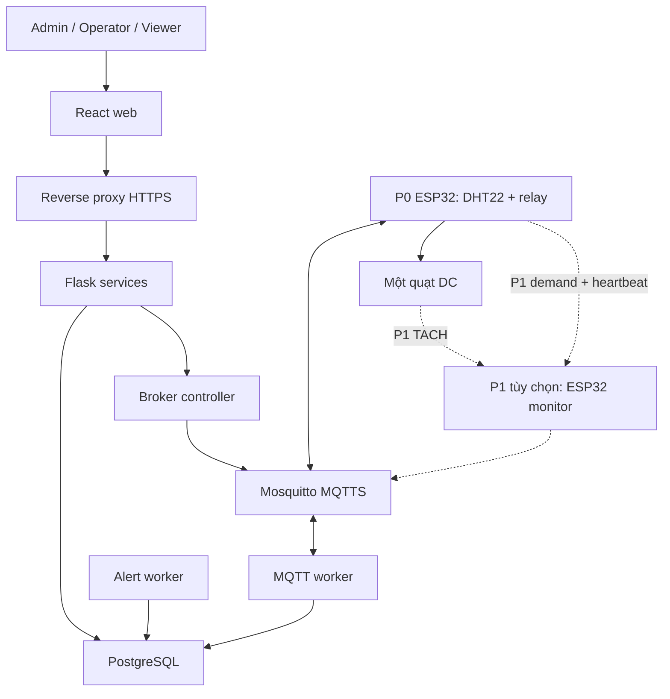
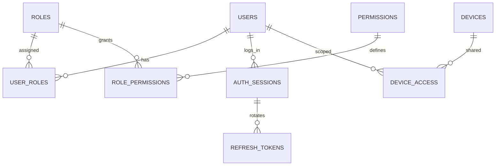
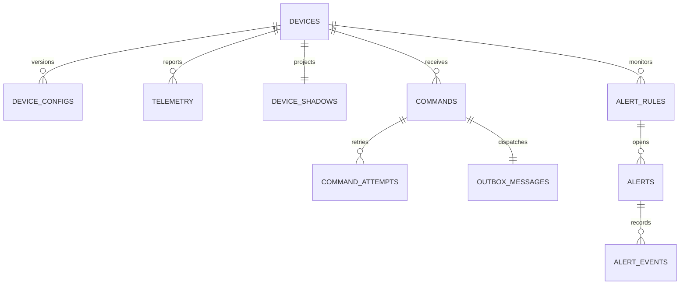
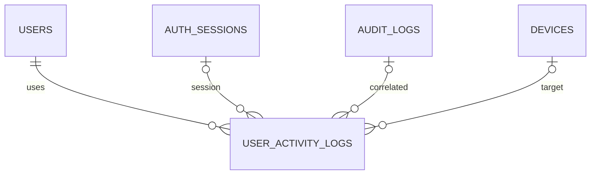
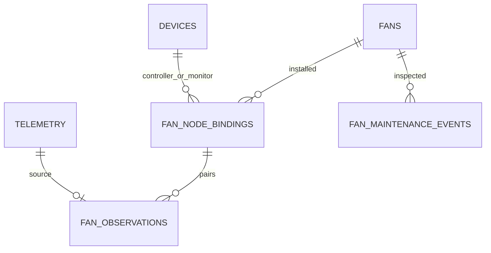
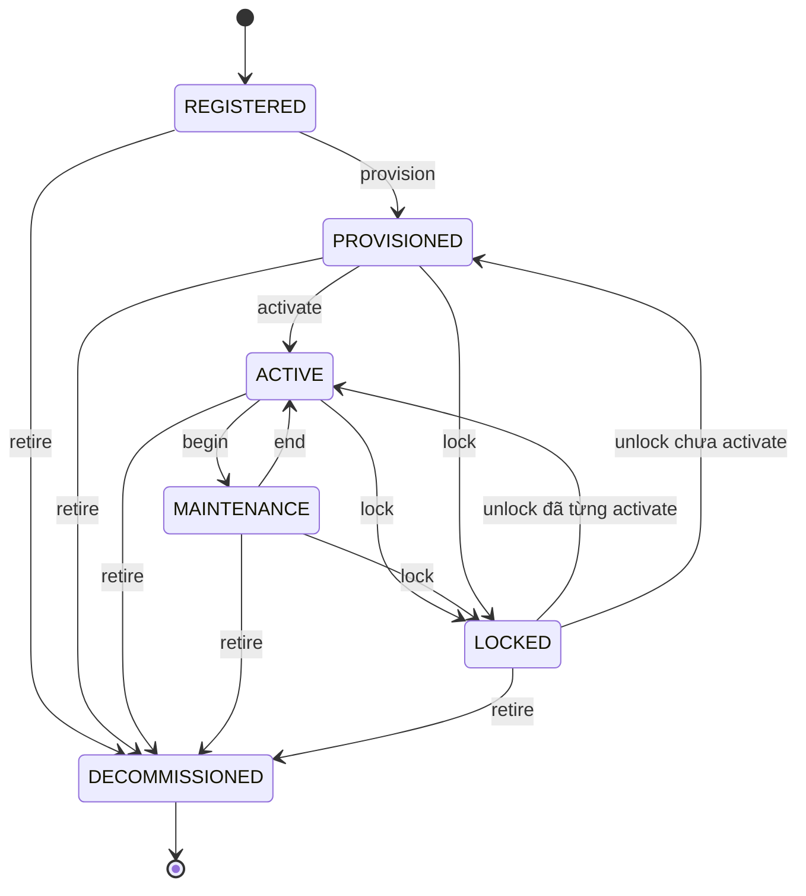
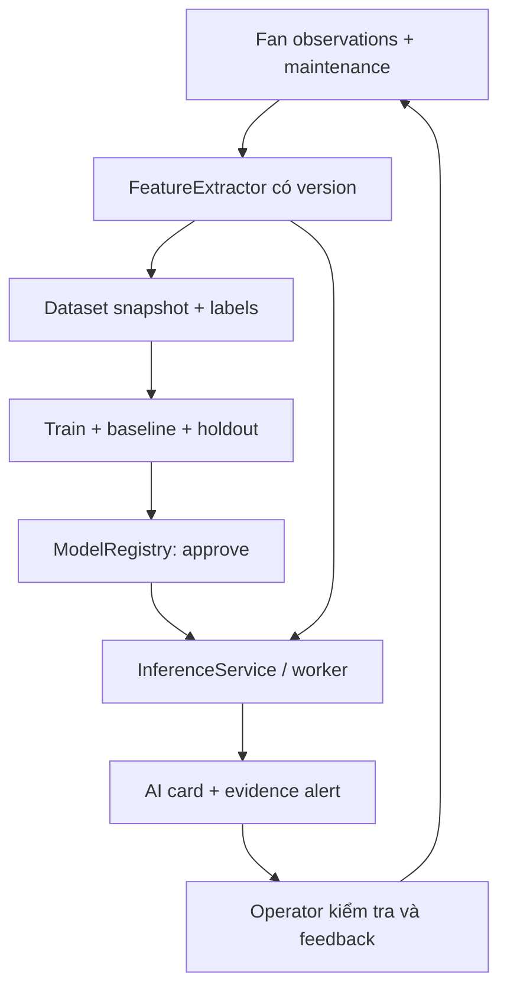
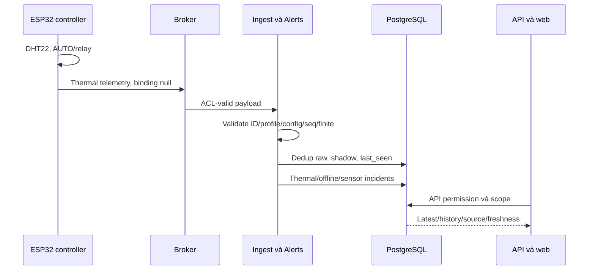
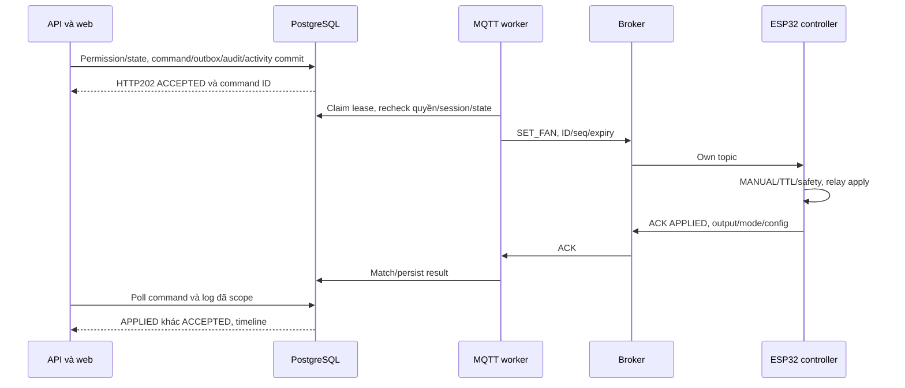
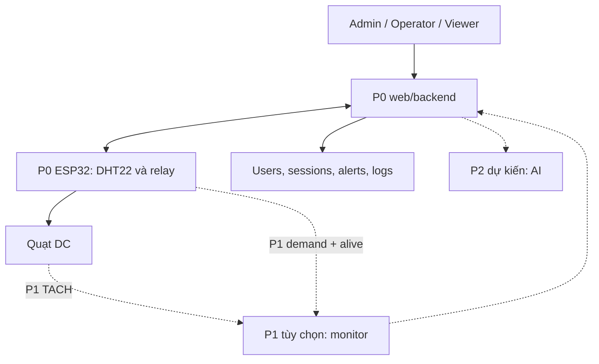

# ĐẶC TẢ CHUNG V1.3 — IoT giám sát nhiệt độ và điều khiển thông gió tủ thiết bị

Bản gốc: 30/09/2026. Rà soát và bổ sung: 09/10/2026. Nhóm: 4 người; giữ phân công TV1–TV4.

V1.3 ưu tiên **P0: một ESP32 đo nhiệt độ/độ ẩm bằng DHT22, điều khiển quạt và hoàn thiện toàn bộ hệ thống web/backend/bảo mật**. **P1: node2 giám sát RPM** là khuyến nghị, chỉ triển khai sau khi P0 đạt nghiệm thu và còn thời gian/thiết bị. **P2: AI dự báo tình trạng quạt** là hướng phát triển có thiết kế sẵn.

Giữ MQTT contract v3 để không đổi topic khi thêm profile monitor; phiên bản tài liệu, payload và firmware là ba khái niệm riêng. Bổ sung bảng nhật ký làm việc user_activity_logs và phần giải thích quyết định công nghệ theo PDF. Đây là đặc tả triển khai; số thời gian/ngưỡng là mục tiêu thử nghiệm, chưa phải kết quả đo.

## 0. Đối chiếu đề bài và quyết định bổ sung

Nguồn chuẩn: **ĐỀ BÀI ĐỒ ÁN KẾT THÚC HỌC PHẦN(3).pdf**,14 trang. Số trang tính từ đầu PDF. Mục4.2 trang3 yêu cầu ít nhất một thiết bị vật lý, khuyến nghị từ hai loại dữ liệu cảm biến và từ hai node cho nhóm4 người. DHT22 cung cấp hai loại dữ liệu nhiệt độ/độ ẩm; hai node không phải điều kiện hoàn thành P0.

| Yêu cầu trong PDF                                                                           | Mức độ / vị trí                           | Quyết định V1.3 / phần triển khai                                               |
| ------------------------------------------------------------------------------------------- | ----------------------------------------- | ------------------------------------------------------------------------------- |
| Bài toán, ràng buộc, lý do IoT, tiêu chí thành công                                         | Bắt buộc,4.1,trang2–3                     | Một tủ/quạt, nhiệt/ẩm thật, AUTO tại edge; mục1,2.3,12                          |
| Ít nhất một node vật lý, ID/cảm biến/đầu ra/config/heartbeat/reconnect                      | Bắt buộc,4.2,trang3                       | P0: một ESP32+DHT22+relay+quạt, mục3–4,8                                        |
| Hai loại dữ liệu cảm biến, hai node nhóm4 người                                             | Khuyến nghị,4.2,trang3                    | P0 có nhiệt/ẩm; P1 đề xuất thêm ESP32 đo RPM nếu đủ điều kiện                   |
| Giao thức IoT hai chiều, timestamp/đơn vị/QoS/retry/timeout/dedup                           | Bắt buộc,4.3,trang4                       | MQTT v3 CONTROLLER trong P0; FAN_MONITOR chỉ P1, mục8                           |
| Backend tự xây dựng; users/lifecycle/data/alerts/commands                                   | Bắt buộc,4.4,trang4–6                     | Services/outbox/operations/desired-applied, mục2,6–9                            |
| Ít nhất ba vai trò                                                                          | Khuyến nghị,4.4,trang4–5                  | ADMIN/OPERATOR/VIEWER, roles/permissions/session/device scope, mục5–6           |
| Auth/password hash/scope/credential/revoke/audit/TLS/privacy                                | Bắt buộc,4.5,trang6                       | Giữ đầy đủ P0; audit_logs và user_activity_logs thêm theo yêu cầu nhóm, mục6.10 |
| UI users/devices/dashboard/history/alerts/config/control                                    | Bắt buộc,4.6,trang7                       | P0 nhiệt/ẩm/relay và nhật ký làm việc; RPM/fan asset chỉ P1                     |
| OTA                                                                                         | Nâng cao,5.1,trang7                       | Thiết kế artifact/job/version/rollback,14.1; chưa yêu cầu P0                    |
| AI IoT có dataset/model/metrics/integration                                                 | Nâng cao,5.2,trang8                       | P2 sau dữ liệu P1, mục14.2                                                      |
| 12 hướng nâng cao khác                                                                      | Nâng cao,5.3,trang8–9                     | Giữ điểm mở rộng module/DB/đánh giá,14.3                                        |
| Context/use case/layers/hardware/deployment/ERD/API/MQTT/2 sequence/lifecycle/roles/threats | Bắt buộc,6,trang9                         | Sơ đồ P0 mục2,6,9,16; P1 ghi rõ tùy chọn                                        |
| Giải thích mỗi lựa chọn kỹ thuật quan trọng                                                 | Bắt buộc,6,trang9                         | Mục2.3: nhu cầu/phương án/lý do/giới hạn; mục11.2 đưa vào báo cáo               |
| Kiểm thử chức năng/bảo mật/phi chức năng                                                    | Bắt buộc,4.5 và7,trang6,9–10              | P0 một node thật+simulator scope; ca RPM/binding riêng P1,12,15                 |
| Repo/release/báo cáo/slide/demo                                                             | Bắt buộc; độ dài khuyến nghị,8,trang10–13 | Mục10–12; báo cáo8.2 trang11 có “Phân tích và lựa chọn giải pháp”               |

### 0.1 Thứ tự ưu tiên và điều kiện chuyển giai đoạn

| Giai đoạn            | Phạm vi                                                                                                                                               | Điều kiện / ảnh hưởng nghiệm thu                                                                            |
| -------------------- | ----------------------------------------------------------------------------------------------------------------------------------------------------- | ----------------------------------------------------------------------------------------------------------- |
| P0 = CORE            | Một node nhiệt/ẩm+AUTO/relay; MQTT; backend/DB; web; RBAC/session; lifecycle/ACL/TLS; alerts/control/config/history; nhật ký làm việc; tests/tài liệu | Hoàn thiện đầu cuối; nghiệm thu được mà không cần node2/RPM/fan binding/AI                                  |
| P1 = EXT khuyến nghị | Node2 RPM/demand/heartbeat; fan asset/binding/maintenance/fusion và fan UI                                                                            | Chỉ bắt đầu khi P0 đạt12.4, bảo mật/tài liệu ổn và còn thời gian/linh kiện; hoãn P1 ghi rõ hướng phát triển |
| P2 = EXT dự kiến     | AI anomaly/risk/RUL; thêm sensor nếu dữ liệu cần                                                                                                      | Phụ thuộc dữ liệu fan P1 và đánh giá; chưa yêu cầu mua sensor/huấn luyện để đạt P0                          |
| EXT khác             | OTA/backfill/rules/cloud...                                                                                                                           | Chọn sau P0, không trì hoãn phần bắt buộc                                                                   |

CORE luôn nghĩa P0. Mô tả hai node/RPM/fan asset ở3.1.2,4.2–4.3,6.9,8.2 và14.2 là P1/P2. Ca P1 chưa triển khai đánh dấu P1_DEFERRED; ca P0 chưa đạt vẫn là FAIL/NOT_RUN.

## 1. Bài toán, phạm vi và tiêu chí hoàn thành

**Tên đề:** Hệ thống IoT giám sát nhiệt độ, độ ẩm và điều khiển thông gió tủ thiết bị mạng.

Người dùng: quản trị hệ thống và người vận hành tủ thiết bị. P0 đo nhiệt/ẩm thật, tự điều khiển quạt tại ESP32, xem web/cảnh báo/lịch sử, quản lý người dùng/thiết bị và xem nhật ký làm việc.

- **P0:1 ESP32 cabinet-001 CONTROLLER +1 DHT22 +1 relay +1 quạt DC thấp áp.** AUTO, web control, remote config và bảo mật phải chạy hoàn chỉnh.
- DHT22 có nhiệt độ và độ ẩm; không cần thêm DHT22 để có hai loại dữ liệu.
- P1 đề xuất fan-monitor-001 đo RPM cùng quạt, demand/heartbeat và báo local; chỉ lắp khi P0 xong và còn điều kiện.
- P0 chưa đo quay: fan_output chỉ đầu ra relay; UI ghi “Đầu ra quạt” và “Chưa có giám sát RPM”, chưa tuyên bố phát hiện quạt hỏng.
- P1 phát hiện thiếu/phản hồi quay bất thường; P2 dự báo nguy cơ hỏng sau dataset phù hợp. RPM0 không tự chứng minh hỏng động cơ/ổ bi.
- Không cần router/switch/server thật; quạt thông gió không làm tủ lạnh hơn môi trường; chưa đo đối chứng không tuyên bố hiệu quả giảm nhiệt/ẩm.
- OLED tùy chọn. Không mở rộng miền ứng dụng ngoài tủ thiết bị; xác nhận đăng ký đề tài với giảng viên.

**Đạt P0 khi:** một node vật lý gửi nhiệt/ẩm thật, AUTO/relay hoạt động; web/backend/DB đầu cuối; đủ10 bước demo12.2; auth/RBAC/session/scope và broker ACL/revoke có test; config/commands/alerts/history/logs có dữ liệu; mất mạng vẫn AUTO; tài liệu/bằng chứng đo đầy đủ. Thiếu node2 hoặc AI không làm P0 thất bại.

### 1.1 Nhu cầu và ràng buộc

- Quản trị viên: tạo tài khoản, gán quyền/tủ, onboarding, khóa, bảo trì; người vận hành: xem trạng thái, xử lý cảnh báo, đổi ngưỡng và điều khiển trong phạm vi; người xem: theo dõi có giới hạn. Giảng viên là người đánh giá, TV1–TV4 là đội triển khai.
- IoT cần thiết vì phải lấy số đo nhiệt/ẩm thật và điều khiển tại tủ; P1 bổ sung kiểm chứng RPM và vận hành AUTO khi backend/mạng mất. Web đơn thuần không thực hiện các chức năng vật lý này.
- Mô hình chạy nguồn DC thấp áp, Wi-Fi 2,4GHz, laptop backend; không cần gateway phần cứng riêng. Edge nằm ngay trên ESP32; điểm truy cập Wi-Fi chỉ chuyển tiếp mạng.
- Ngân sách: TV1 lập BOM **P0 một node trước**, điền giá/nguồn mua thật; tách chi phí P1 và chỉ mua bổ sung sau quyết định triển khai. Tính dòng ESP32/relay/quạt/LED-còi và dự phòng khởi động; mở rộng nguồn cho node2 khi cần.
- Không thu camera/microphone/vị trí GPS; thông tin cá nhân chỉ username, tên hiển thị và metadata phiên tối thiểu. Email tùy chọn khi triển khai thông báo/khôi phục mật khẩu.
- Chức năng không đạt không được ghi thành kết quả. Mục tiêu độ trễ/ổn định ở mục 12 phải có dữ liệu đo, cấu hình máy/mạng và nhận xét giới hạn.

## 2. Công nghệ thống nhất

| Khối                | Chốt dùng                                                                                                                                          | Lý do và quy tắc                                                                                                                                      |
| ------------------- | -------------------------------------------------------------------------------------------------------------------------------------------------- | ----------------------------------------------------------------------------------------------------------------------------------------------------- |
| Bo                  | ESP32 DevKit dòng WROOM-32, 30 chân, CH340, USB-C, đã hàn chân                                                                                     | Bám hướng dẫn ESP32 thường; CH340 chỉ là cầu USB–UART. Nếu đã mua CP2102/bo 38 chân vẫn dùng được, phải ghi lại pinout thật                           |
| Cảm biến            | P0:1 DHT22; P1:TACH RPM                                                                                                                            | P0 có nhiệt/ẩm; RPM thuộc mở rộng, không bắt mua thêm sensor P0                                                                                       |
| Quạt                | P0:quạt DC5V hai dây hiện có; P1:TACH hoặc adapter đo quay                                                                                         | Không bắt đổi quạt để đạt P0. Khi làm P1 mới kiểm tín hiệu/PPR; CORE giữ ON/OFF                                                                       |
| Điều khiển quạt     | Relay module một kênh (hoặc dùng một kênh của module hai kênh), nhận tín hiệu 3,3V                                                                 | Xác minh mức kích HIGH/LOW và điện áp nuôi theo module thực tế                                                                                        |
| Firmware            | C/C++, Arduino IDE/core ESP32; P0 CONTROLLER, P1 thêm FAN_MONITOR qua common modules                                                               | Cả nhóm dùng một phiên bản core đã kiểm tra; TV1 ghi phiên bản vào README                                                                             |
| Thư viện firmware   | DHT sensor library của Adafruit + Adafruit Unified Sensor; PubSubClient; ArduinoJson; Preferences; adapter đếm xung PCNT hoặc ISR ngắn đã kiểm thử | Khóa phiên bản sau khi build thử. Wokwi có thể cần DHTesp cho cảm biến mô phỏng; không coi khác biệt mô phỏng là đổi hợp đồng firmware                |
| Mạng                | Wi-Fi 2,4GHz, MQTT                                                                                                                                 | Thiết bị cố định có nguồn; MQTT đi hai chiều                                                                                                          |
| Broker              | Eclipse Mosquitto + Dynamic Security plugin                                                                                                        | Có tài khoản riêng, ACL và thu hồi kết nối khi đang chạy                                                                                              |
| Backend             | Python + Flask; SQLAlchemy; Flask-Migrate; paho-mqtt; Flask-JWT-Extended cho access JWT; service riêng cho opaque refresh token                    | Một ứng dụng chung chia Blueprint; một worker MQTT                                                                                                    |
| Mật khẩu người dùng | argon2-cffi, Argon2id qua PasswordHasher                                                                                                           | Mốc cấu hình tối thiểu: memory_cost=19456 KiB, time_cost=2, parallelism=1; đo thời gian trên laptop và tăng nếu phù hợp; không tự viết thuật toán băm |
| DB                  | PostgreSQL 16, database `iot_cabinet`                                                                                                              | DB duy nhất cho tích hợp, kiểm thử và bàn giao; không chia MySQL/SQLite/Firebase                                                                      |
| Frontend            | React + Vite, JavaScript; React Router; Recharts; fetch                                                                                            | Web responsive; V1.3 polling API mỗi 2 giây để giảm độ phức tạp                                                                                       |
| Triển khai chuẩn    | Docker Compose cho PostgreSQL, Mosquitto, reverse proxy HTTPS, backend API, MQTT worker, alert worker                                              | TV4 tổ chức; TV2/TV3 cung cấp config phần mình. ESP32 chạy ngoài Docker                                                                               |
| Công cụ             | GitHub, VS Code, Arduino IDE, Wokwi, Postman hoặc Bruno, MQTT Explorer, DBeaver                                                                    | Wokwi thử phần nhúng; API và broker thử riêng bằng máy tính                                                                                           |

**Phiên bản:** TV2/TV4 tạo requirements và package-lock; TV1 ghi version Arduino core/library. Sau commit nền chạy được, nhóm không tự nâng cấp phiên bản riêng. Mosquitto phải chọn bản có Dynamic Security đã thử, ghi chính xác tag vào deployment, không dùng tag `latest` ở bản bàn giao.

**Cấu hình demo:** laptop chạy dịch vụ; ESP32 và máy mở web cùng mạng có thể giao tiếp với laptop. Điện thoại hotspot không tự biến backend thành dịch vụ truy cập từ Internet. Broker URL trong ESP32 dùng IP LAN laptop, không dùng `localhost`. Giai đoạn nối mạch có thể dùng HTTP/MQTT trong LAN thử nghiệm; không gửi credential thật qua mạng dùng chung. **Mục tiêu bàn giao HTTPS + MQTTS**: CA nội bộ cho laptop, chứng thư có SAN đúng hostname/IP, cài CA cho trình duyệt và ESP32. WiFiClientSecure phải kiểm tra CA/hostname; không dùng setInsecure. Nếu môi trường demo thật sự không hỗ trợ, báo cáo ghi phần chưa mã hóa và lý do theo điều kiện của PDF, không đánh dấu đã đạt TLS. MQTTS là TCP 8883; chỉ mở 1883 cho profile development. Không publish PostgreSQL ra mạng chung.

### 2.1 Kiến trúc tổng thể và ranh giới module



P0 độc lập với N2/FanFusionService/fan binding/AI. CONTROLLER đọc DHT22 và điều khiển relay; P1 thêm FAN_MONITOR đọc TACH/demand/heartbeat và chỉ nhận config. React gọi API; quyền/domain không phụ thuộc số node.

| Lớp PDF      | P0                                                   | Điểm mở rộng                                     |
| ------------ | ---------------------------------------------------- | ------------------------------------------------ |
| Thiết bị     | ESP32+DHT22+relay, AUTO/safety                       | P1 RpmSensor/profile FAN_MONITOR                 |
| Kết nối      | Wi-Fi+MQTTS; web HTTPS                               | Protocol adapter vào domain events               |
| Edge/gateway | AUTO trên ESP32, không cần bo gateway                | Buffer/preprocessing/gateway EXT                 |
| Backend      | Blueprints/services/repositories, MQTT/alert workers | P1 Fusion; P2 inference worker; cùng auth        |
| Dữ liệu      | PostgreSQL27 bảng CORE, migration/backup             | P1 thêm4 bảng fan+nullable FKs; P2 dataset/model |
| Ứng dụng     | Thermal dashboard/users/devices/alerts/logs          | P1 fan overview; P2 AI advisory                  |

CommandService tạo lệnh, PermissionService tính quyền, ConfigService quản lý snapshot/version, AlertService quản lý incident, UserActivityService ghi nhật ký chức năng. Domain/service không import React/broker SDK/model AI. Broker controller là module durable device operations, không dựng backend riêng.

### 2.2 Triển khai, giao dịch và hoạt động khi lỗi

- API có thể nhiều process. V1.3 chạy **một MQTT worker và một alert worker**; không subscribe MQTT trong app factory/Gunicorn mỗi process. Worker có healthcheck và restart policy.
- API tạo `commands + outbox_messages + audit_logs + user_activity_logs` trong một transaction DB, rồi trả 202. Gửi MQTT ngoài transaction; outbox có lease/retry. Broker PUBACK chỉ là đã tới broker, không phải thiết bị đã thực hiện.
- Trước dispatch/retry: kiểm tra hạn lệnh, trạng thái device và quyền hiện tại. Lệnh USER thủ công phải còn session/account hợp lệ; mất quyền/session thì CANCELLED. Cấu hình đã lưu là thay đổi bền vững: hết hạn session không tự xóa desired config; trước lần apply đầu tiên phải kiểm tra người tạo vẫn ACTIVE và có device.configure, còn config đã applied không bị đảo ngược chỉ vì người tạo logout. SYSTEM re-sync config phải tham chiếu config được duyệt theo policy này, không biến lệnh MANUAL của user bị revoke thành SYSTEM. Mọi nguồn đều tuân thủ khóa/fault/safety.
- DB và broker không có transaction chung. Provision/activate/lock/decommission dùng `device_operations` + desired/actual broker state; có operation_id/status/error, retry/reconcile sau crash. Lock/revoke đặt backend deny ngay; chỉ báo hoàn tất khi broker xác nhận disable và kiểm tra reconnect bị từ chối. Broker lỗi thì operation FAILED/PENDING và UI hiển thị, không thành công giả.
- Broker/DB/API mất: node1 P0 vẫn AUTO; nếu có P1, node2 vẫn đo TACH và cảnh báo local từ demand/heartbeat có dây, dùng cấu hình đã áp dụng. DB mất thì worker không xác nhận đã lưu; profile QoS0 V1.3 có thể mất bản tin, phải biểu diễn khoảng trống. Broker lưu persistence cho retained/config security, không phải kho lưu mọi telemetry.
- Workers ghi transaction ngắn; acquire row lock theo thứ tự cố định. Mở rộng nhiều worker phải thêm lease/partition theo device_id, chống đánh giá incident đồng thời; không chỉ tăng số container.
- Backup gồm PostgreSQL, cấu hình Dynamic Security, CA/config, firmware config; secret backup được bảo vệ. Kiểm thử restore trên môi trường tách biệt. API `/health/live` và `/health/ready`; readiness không thành công khi DB hoặc worker thiết yếu chưa sẵn sàng.
- TLS terminate cho web ở reverse proxy; broker tự phục vụ MQTTS. Compose network riêng cho DB/backend; frontend bundle served cùng origin để đơn giản hóa cookie/CORS.

### 2.3 Giải thích lựa chọn công nghệ và phương án thay thế (bắt buộc theo PDF)

PDF mục6 trang9 yêu cầu: **“Mỗi lựa chọn kỹ thuật quan trọng phải có giải thích, không chỉ liệt kê công nghệ.”** Mục4.1 trang2–3 yêu cầu lý do cần IoT; mục8.2 trang11 đề xuất phần “Phân tích và lựa chọn giải pháp”. Bảng này làm nền cho báo cáo/bảo vệ; đổi công nghệ phải cập nhật lý do và test thật.

| Quyết định                 | Nhu cầu / lựa chọn                                    | Phương án cân nhắc / lý do chọn                                                                                      | Giới hạn / kiểm chứng                                                            |
| -------------------------- | ----------------------------------------------------- | -------------------------------------------------------------------------------------------------------------------- | -------------------------------------------------------------------------------- |
| IoT thay vì chỉ web        | Đo nhiệt/ẩm và điều khiển vật lý tại tủ               | Web quản lý/hiển thị; ESP32 thực hiện đo và AUTO khi mất mạng                                                        | Demo mất backend vẫn AUTO; không dùng mock chứng minh đo thật                    |
| Một node trước             | P0 nhiệt/ẩm+relay, P1 monitor                         | Hai node tăng phần cứng/config/tests; hoàn thành yêu cầu tối thiểu trước                                             | PDF≥1 vật lý, khuyến nghị≥2; chưa làm P1 ghi hướng phát triển                    |
| ESP32                      | Bo đã chọn, Wi-Fi và GPIO                             | Raspberry Pi/gateway không cần cho loop đơn giản; giữ ESP32 giảm công lắp                                            | Kiểm pinout/nguồn bo thật; không đổi bo chỉ vì thông số cao                      |
| DHT22                      | Một module có nhiệt/ẩm, linh kiện/kế hoạch hiện tại   | DHT11 là phương án khác; giữ DHT22 tránh đổi driver giữa tích hợp, không dùng độ chính xác chưa xác minh làm kết quả | Sampling2s thử theo thư viện; nhiệt kế đối chiếu, ghi độ lệch                    |
| Quạt DC+relay              | AUTO ON/OFF+hysteresis, DC thấp áp                    | PWM/MOSFET cho điều tốc nếu mở rộng; P0 giữ relay đã chọn                                                            | Kiểm active HIGH/LOW/nguồn; ACK chưa chứng minh quay                             |
| Wi-Fi                      | Node cố định có nguồn, LAN demo                       | BLE/LoRa/gateway chưa cần cho một tủ; hotspot chỉ cấp mạng LAN nếu dùng                                              | Kiểm inter-client access và đo reconnect                                         |
| MQTT+Mosquitto             | Pub/sub telemetry/status/commands/ACK, ACL/revoke     | REST dùng web; HTTP polling trực tiếp node thay vòng nhận lệnh/heartbeat nên không chọn                              | PubSubClient publishQoS0 cần đo loss; broker không là DB; retained không là live |
| Arduino/C++                | DHT/relay nhanh, ví dụ/mạch dễ đối chiếu              | ESP-IDF thuần cho driver sâu hơn; P0 chưa cần chuyển framework                                                       | Pin core/library; network không block AUTO; P1 PCNT build đúng phiên bản         |
| Flask/Python               | Backend tự xây+workers chung codebase                 | FastAPI/Node.js cũng phù hợp; chốt Flask thống nhất giao việc, không nói nhanh hơn mọi framework                     | Không subscribe trong mỗi Gunicorn process; test transaction/revoke              |
| PostgreSQL                 | FK/transactions/indexes, nhiều quan hệ IAM/device/log | SQLite tiện thử; MongoDB/Firebase mô hình khác; cần một DB tích hợp có quan hệ chặt                                  | Migration/restore, đo indexes/WAL/EXPLAIN; chưa cần time-series extension        |
| SQLAlchemy/Alembic         | Models/repositories/schema version                    | Giữ một migration source giảm schema lệch thay vì mỗi người SQL riêng                                                | FK/CHECK vẫn cần; test empty DB/upgrade                                          |
| React+REST+poll2s          | Dashboard/quản trị cùng origin                        | SSE/WebSocket push là EXT; polling giảm công scope/reconnect/resume P0                                               | Không tải toàn history mỗi tick; đo p95, chưa gọi hard real-time                 |
| RBAC+device scope          | ADMIN/OPERATOR/VIEWER và VIEW/OPERATE                 | Role đơn thuần không chặn đọc thiết bị ngoài scope; UI ẩn nút chưa bảo vệ API                                        | SQL lists/exports và test403/404; MQTT ACL theo ID                               |
| JWT+session+opaque refresh | Access ngắn hạn, sid check, rotation/revoke           | JWT stateless đơn thuần khó thu hồi ngay; sid check để logout/lock có hiệu lực                                       | Secure/HttpOnly/CSRF/TTL/idle/token hashes/re-auth có test                       |
| Argon2id/TLS/ACL           | Bảo vệ password/đường truyền/topic                    | Không tự viết hash; CA verify hostname; credential mỗi node                                                          | Đo hash cost, SAN/cert, reconnect deny; không setInsecure                        |
| Outbox+ACK+operations      | DB và broker không có transaction chung               | Durable jobs để retry/reconcile sau crash; publish ngay chưa đủ phục hồi                                             | 202/PUBACK/APPLIED khác nhau; retry cùng ID, dedup, crash tests                  |
| Nhật ký chức năng+audit    | Ai dùng chức năng gì và kiểm toán nhạy cảm            | Structured logs debug cần thêm bảng business log để query theo user/function                                         | Backend xác định actor/result, append-only/redaction; không log mỗi poll         |
| Docker Compose             | Môi trường DB/broker/API/workers/proxy thống nhất     | Cài rời dễ lệch cấu hình giữa thành viên                                                                             | README/env/tag/volumes/healthcheck, máy sạch; ESP32 ngoài Docker                 |
| P1 RPM/P2 AI               | Kiểm chứng quay trước dữ liệu dự báo                  | TACH/optical/Hall qua adapter; dòng/áp/rung theo dữ liệu cần                                                         | P1/P2 tùy chọn, fixture/labels/holdout; không suy failure từ relay/RPM0          |

Mỗi thành viên giải thích phần mình theo yêu cầu→phương án→lý do→trade-off→bằng chứng. TV4 tổng hợp; slide trình bày quyết định/kết quả thay vì chỉ đọc thư viện.

## 3. Linh kiện và nối dây: mua P0 trước, P1 khi có điều kiện

### 3.1 BOM theo giai đoạn

#### 3.1.1 P0 cần hoàn thành trước

| Món                            | Số lượng | Ghi chú                                          |
| ------------------------------ | -------: | ------------------------------------------------ |
| ESP32 WROOM-32+cáp USB dữ liệu |        1 | Một controller, credential riêng                 |
| DHT22 module                   |        1 | Nhiệt/ẩm, kiểm nguồn/pull-up3,3V                 |
| Relay input3,3V                |        1 | Kiểm nguồn/mức kích HIGH-LOW                     |
| Quạt DC5V                      |        1 | Hai dây hiện có dùng được; P0 không bắt TACH     |
| LED+trở330Ω                    |     2 bộ | Còi/OLED tùy chọn                                |
| Breadboard/dây/đầu nối/gá tủ   |     1 bộ | Gá dây tránh cánh, chọn dây tải đúng             |
| Nguồn5V đủ dòng                |     1 bộ | Tính dòng ESP32/relay/quạt và dự phòng khởi động |
| Nhiệt kế đối chiếu             |     Mượn | Độ lệch/phương pháp đo thật                      |

P0 cần **1 ESP32+1 DHT22+1 relay+1 quạt**; xong mạch và web/backend/DB/bảo mật trước mua P1.

#### 3.1.2 P1 khuyến nghị sau P0

| Món bổ sung                     |       Số lượng | Điều kiện                                                |
| ------------------------------- | -------------: | -------------------------------------------------------- |
| ESP32 monitor+cáp USB           |              1 | Chỉ mua khi nhóm chọn node2                              |
| TACH hoặc optical/Hall adapter  |     1 đường đo | Cùng quạt P0 nếu hỗ trợ; thay quạt ghi asset mới         |
| Pull-up3,3V/chuyển mức          | Theo datasheet | Open-collector xác minh; khởi đầu4,7kΩ rồi kiểm tín hiệu |
| Demand+heartbeat+GND            |           1 bộ | Hai tín hiệu3,3V; series1kΩ/pulldown10kΩ phía monitor    |
| LED+trở và còi3,3V              |    2 LED+1 còi | Báo local, kiểm dòng/mức kích                            |
| Dây/gá/breadboard/nguồn bổ sung |      Theo mạch | Tính hai bo/tải thật, không mặc định5V/2A đủ             |
| Pulse generator/RPM đối chiếu   |   Mượn/phép đo | Kiểm PPR/window/count; fixture không là fan thật         |

P1 ưu tiên TACH có datasheet; optical/Hall cần kiểm gá/PPR/GPIO. Relay/dòng không thay phép đo quay. Dòng/điện áp/rung là P2 tùy chọn, không mua để đạt P0.

### 3.2 Pinout: P0 dùng node1; node2 và dây liên kết chỉ P1

P0 nối DHT/relay/LED/nguồn. GPIO demand/alive chỉ dành chỗ, chưa cần phát tín hiệu giám sát hoặc nối dây; khi bật P1 mới lắp thêm đường bên dưới.

| Chức năng                                      | Node 1 GPIO |                    Node 2 GPIO |
| ---------------------------------------------- | ----------: | -----------------------------: |
| DHT22 DATA                                     |          23 |                     Không dùng |
| Relay IN                                       |          18 |                     Không dùng |
| Fan demand mirror: HIGH=đang yêu cầu đầu ra ON |   27 OUTPUT |              27 INPUT pulldown |
| Controller alive: đảo mức mỗi500ms             |   32 OUTPUT |              33 INPUT pulldown |
| TACH / xung RPM                                |  Không dùng | 23 INPUT pull-up3,3V theo mạch |
| LED mạng / cảnh báo                            |     19 / 25 |                        19 / 25 |
| Còi module IN                                  | 26 tùy chọn |                             26 |
| OLED EXT SDA/SCL                               |     21 / 22 |                        21 / 22 |

- GPIO là nhãn chân chức năng, TV1 kiểm pinout bo mua thật. DHT22 cấp3,3V khi module hỗ trợ; không đưa tín hiệu5V/12V vào ESP32.
- Nhánh tải: +5V→relay COM→NO→fan power; fan GND→GND nguồn. Node 1 xuất demand mirror từ **trạng thái driver đã áp dụng**, không từ HTTP request/desired chưa ACK. Mirror không chứng minh relay tiếp điểm đã đóng hay nguồn fan còn tốt.
- Hai ESP32 và quạt có GND tham chiếu chung theo sơ đồ nguồn. Demand/heartbeat từ GPIO node 1 vào INPUT node 2 qua series1kΩ/pulldown10kΩ; không nối hai OUTPUT vào nhau. Heartbeat chỉ đảo mức khi vòng control node 1 còn chạy; không phát từ task riêng vẫn sống trong khi control task đã treo.
- Đường TACH tách khỏi đường nguồn relay. Với TACH open-collector được datasheet xác nhận: kéo lên3,3V tại node 2, đọc một cạnh/xung. Nếu output đã kéo lên điện áp khác, dùng chuyển mức phù hợp trước nối GPIO. Chọn PPR theo tài liệu/đo, không mặc định mọi quạt đều2 xung/vòng.
- Khi fan mất nguồn mà TACH vẫn có pull-up, kiểm tra datasheet việc cấp ngược qua chân signal; bổ sung buffer/series nếu cần. TV1 thử fan OFF/ON và kiểm mức điện áp trước ghép hai bo. Không thêm tụ lọc tùy ý làm mất xung, cấu hình PCNT glitch filter theo xung thật.
- Không cấp dòng quạt từ GPIO; không ghép USB và nguồn ngoài vào chân5V bo khi chưa xác minh đường nguồn. Hộp/gá giữ dây khỏi cánh, dùng DC thấp áp.

### 3.3 Đo RPM (P1 tùy chọn)

Node 2 đếm một cạnh/xung trong cửa sổ bằng PCNT; ISR ngắn là fallback nếu phiên bản core không hỗ trợ API PCNT đã chọn. Không count đồng thời rising+falling rồi vẫn dùng PPR một cạnh.

`rpm = pulse_count * 60000 / (window_ms * pulses_per_revolution)`.

Ví dụ test2 xung/vòng, cửa sổ1000ms,150 xung ⇒4500RPM. PPR2 chỉ là fixture, phải xác minh quạt thật. Ghi pulse_count/window_ms/PPR bên cạnh RPM để sau này kiểm tra lại công thức/calibration; validate hữu hạn, không NaN/Infinity. Counter snapshot atomic, không mất xung lúc clear; đo thời gian cửa sổ thực bằng monotonic clock.

## 4. P0 controller và P1 monitor tùy chọn

### 4.1 P0: node1 CONTROLLER nhiệt/ẩm và AUTO

| Tham số                          | Mặc định thử nghiệm                                                       |
| -------------------------------- | ------------------------------------------------------------------------- |
| DHT22 sample / telemetry         | 2s / 5s                                                                   |
| MQTT heartbeat / backend offline | 15s /45s không có live message hợp lệ                                     |
| AUTO hysteresis                  | fan_on_c=30, fan_off_c=28                                                 |
| Cảnh báo nhiệt/ẩm                | 35°C /80%RH, tồn tại10s; clear margins1°C /3%RH                           |
| MANUAL TTL                       | 60s, miền10–300s; hết TTL→AUTO                                            |
| Wi-Fi/MQTT mất                   | AUTO ngay, giữ applied config và phát demand/heartbeat có dây             |
| DHT lỗi                          | 3 lần lỗi liên tiếp→FAULT, yêu cầu fanON, nhiệt/ẩm null;3 lần hợp lệ→AUTO |

Khởi động dùng fallback/config NVS, control không chờ NTP/backend. `fan_output` là yêu cầu đầu ra relay đã áp dụng, không là RPM. Khi bật P1, node1 phản ánh demand mirror ngay khi thay driver, kể cả FAULT/fallback. Mất mạng/FAULT thắng MANUAL OFF; không bật/tắt thử tự động liên tục khi báo mất RPM. Node 2 không can thiệp relay. Firmware tổ chức control/sampling loop không bị MQTT reconnect/TLS blocking lâu; network task trao đổi queue với loop hoặc reconnect nonblocking/timeout được đo; heartbeat có dây phản ánh loop điều khiển thật.

### 4.2 P1 khuyến nghị: FAN_MONITOR, RPM+demand

Chỉ triển khai sau nghiệm thu P0 nếu còn điều kiện; P0 không cần RPM/heartbeat dây/binding để AUTO và điều khiển quạt.

| Tham số                          | Mặc định thử nghiệm                               |
| -------------------------------- | ------------------------------------------------- |
| Cửa sổ RPM                       | 1000ms, một cạnh/xung                             |
| Telemetry monitor                | 2s, kèm latest RPM/min/max hai cửa sổ gần nhất    |
| PPR                              | 2 chỉ khi datasheet/fixture xác nhận, cấu hình1–8 |
| Startup grace                    | 3000ms từ cạnh demandOFF→ON hợp lệ                |
| No-rotation persistence          | 3000ms không có xung liên tục sau grace           |
| Stop grace                       | 3000ms từ demandON→OFF để loại quán tính          |
| Controller heartbeat timeout     | 3500ms không thấy cạnh heartbeat                  |
| Node heartbeat / backend offline | 15s /45s; telemetry2s cũng gia hạn online         |

Logic chạy bằng monotonic timers tại node 2, không chờ timestamp NTP. Node 2 cần config đã lưu/applied local có binding_id hợp lệ; không phải chờ backend tuyên bố ACTIVE mới report binding (tránh vòng phụ thuộc onboarding); chưa gán thì UNKNOWN/UNASSIGNED, vẫn gửi số xung phục vụ onboarding.

| Điều kiện                                             | fan_state / xử lý                                                                                                                         |
| ----------------------------------------------------- | ----------------------------------------------------------------------------------------------------------------------------------------- |
| DemandON, heartbeat còn mới, đang trong startup grace | STARTING; chưa báo lỗi thiếu xung                                                                                                         |
| DemandON, heartbeat hợp lệ, có xung/RPM>0             | RUNNING                                                                                                                                   |
| DemandON, qua grace, không có xung đủ persistence     | NO_ROTATION_FEEDBACK; LED/còi local + telemetry cảnh báo                                                                                  |
| DemandOFF, qua stop grace và RPM=0                    | STOPPED; RPM0 là bình thường, không báo quạt hỏng                                                                                         |
| DemandOFF, qua stop grace nhưng còn xung quay         | UNEXPECTED_ROTATION; cảnh báo FAN_UNEXPECTED_ROTATION, lưu bằng chứng; chưa kết luận relay dính vì vẫn có thể có luồng gió ngoài làm quay |
| DemandOFF đang giảm tốc                               | STOPPING; lưu RPM, không coi là nguồn lỗi                                                                                                 |
| Heartbeat mất/driver TACH lỗi/binding chưa xác nhận   | UNKNOWN; reason CONTROLLER_SIGNAL_LOST/RPM_DRIVER_FAULT/UNASSIGNED, không kết luận hỏng quạt                                              |

Khi boot/config change/binding change/control signal mất: reset bộ đếm startup/persistence; khi heartbeat trở lại mà demandON, cho startup grace mới. ACK/profile type của node 2 chỉ hỗ trợ APPLY_CONFIG; không SET_FAN/SET_MODE. PCNT hoạt động nhưng0 xung không phân biệt quạt dừng với TACH đứt dây; `RPM_DRIVER_FAULT` chỉ cho lỗi driver được phát hiện thật.

### 4.3 P1: kết luận fan; quy tắc clock dùng chung

- P1 cảnh báo **thiếu phản hồi quay khi đầu ra đang ON**, không xác định nguyên nhân hỏng. Quạt mất nguồn/relay lỗi/TACH đứt cũng tạo cùng triệu chứng; người vận hành ghi nguyên nhân đã kiểm tra ở maintenance event.
- Node 2 mất MQTT vẫn đo/đánh giá local qua dây; web hiển thị node monitor OFFLINE, tình trạng quạt STALE/UNKNOWN sau cửa sổ dữ liệu mới tối đa6s, không giữ chữ RUNNING màu xanh vô hạn. Node 1 mất Wi-Fi nhưng control loop còn chạy, heartbeat có dây vẫn mới và monitor vẫn đánh giá được.
- Node 1 mất nguồn/treo làm heartbeat mất: node 2 chuyển UNKNOWN + cảnh báo MONITOR_INPUT_LOST; không dùng demand bị pulldown vềOFF để khẳng định quạt đang được tắt bình thường. Không lấy retained desired làm nguồn truth cho giám sát.
- Clock chưa sync: measured_at=null/clock_synced=false, lưu received_at/uptime/window; command từ xa có hạn yêu cầu clock tin cậy. Deployment dùng Internet hoặc NTP LAN. CORE chưa replay offline telemetry; buffer/backfill EXT.
- Các ngưỡng là cấu hình thử, đo startup thật rồi điều chỉnh. Sensor driver/config/library versions và nguồn điện phải ghi cùng dữ liệu, đặc biệt khi đổi quạt/PPR/cảm biến.

## 5. Vai trò, quyền và quản lý phiên

### 5.1 RBAC và phạm vi thiết bị

Role được lưu ở `roles/user_roles`; khả năng ở `permissions/role_permissions`; phạm vi ở `device_access`. **Không giữ thêm users.role làm nguồn quyền thứ hai.** V1.3 mỗi user đúng một role hệ thống; schema quan hệ cho phép mở rộng nhiều role bằng migration sau. Chỉ seed ADMIN/OPERATOR/VIEWER, chưa xây giao diện sửa arbitrary permissions.

Với device permission: `allow = user ACTIVE + session hợp lệ + role chứa permission + scope được cấp đủ mức + trạng thái nghiệp vụ hợp lệ`. ADMIN có permission hệ thống và scope toàn bộ, vẫn tuân thủ trạng thái khóa/fault và quy tắc an toàn. Ownership, location và group không tự cấp quyền.

| Hành động / permission                                                                                                                  | ADMIN           | OPERATOR       | VIEWER     | Scope / điều kiện                                                  |
| --------------------------------------------------------------------------------------------------------------------------------------- | --------------- | -------------- | ---------- | ------------------------------------------------------------------ |
| `device.read`, `telemetry.read`, `telemetry.export`, `command.read`, `alert.read`, `activity.read`                                      | Có              | Có             | Có         | VIEW hoặc OPERATE trên device                                      |
| `device.control`, `device.configure`, `alert.acknowledge`, `alert.resolve`                                                              | Có              | Có             | Không      | OPERATE; trạng thái cho phép                                       |
| `user.read`, `user.create`, `user.update`, `user.lock`, `user.role.assign`, `user.password.reset`                                       | Có              | Không          | Không      | Toàn hệ thống; re-auth cho thao tác nhạy cảm                       |
| `device.register`, `device.provision`, `device.activate`, `device.access.manage`, `device.lifecycle.manage`, `device.credential.rotate` | Có              | Không          | Không      | Quản trị; không cho user tự nâng quyền                             |
| `location.manage`, `device_group.manage`                                                                                                | Có              | Không          | Không      | Nhóm/vị trí phục vụ tổ chức, chưa kế thừa quyền                    |
| `fan.read` (P1)                                                                                                                         | Khi bật P1      | Khi bật P1     | Khi bật P1 | VIEW cả hai node của binding                                       |
| `fan.maintain` (P1)                                                                                                                     | Khi bật P1      | Khi bật P1     | Không      | OPERATE cả hai node, note/nhãn có audit                            |
| `fan.manage` (P1)                                                                                                                       | Khi bật P1      | Không          | Không      | Asset/binding/replacement                                          |
| `audit.read`                                                                                                                            | Có              | Không          | Không      | Audit bảo mật/quản trị chỉ admin                                   |
| `user_activity.read`                                                                                                                    | Có              | Không          | Không      | Nhật ký chức năng mọi user, đã redaction                           |
| `user_activity.self.read`                                                                                                               | Có              | Có             | Có         | Chỉ nhật ký chức năng bản thân                                     |
| `profile.update`, `password.change`, `session.self.manage`                                                                              | Có              | Có             | Có         | Chỉ bản thân                                                       |
| `session.admin.revoke`                                                                                                                  | Có              | Không          | Không      | Session user khác; ghi audit                                       |
| `firmware.manage`, `ota.deploy`, `ai.model.manage`, `automation.manage`                                                                 | Sau khi bật EXT | Không mặc định | Không      | Chỉ seed permission khi triển khai module; target cần scope/safety |

`VIEW` cho phép nhóm read/export; `OPERATE` bao gồm VIEW và bốn thao tác vận hành. Operator có VIEW chỉ xem; Viewer được gán nhầm OPERATE vẫn không điều khiển. Default deny cho permission không tồn tại/không được gán. Endpoint list, statistics, export, alerts và activity phải lọc scope tại SQL; không tải toàn DB rồi lọc ở frontend.

`PermissionService.require(permission, device_id=None)` và `visible_devices_query(user)` do TV3 cung cấp; TV2/TV4 gọi ở mọi API/service nhạy cảm. Dữ liệu ID chưa được cấp scope trả 404 để không lộ tồn tại; đã có VIEW nhưng thiếu quyền hành động trả 403. Kiểm thử Viewer control trên device được VIEW phải trả 403.

### 5.2 Login, access JWT và refresh token

1. Admin tạo tài khoản V1.3; không cần public registration. Bootstrap admin từ biến môi trường/script một lần, không credential mặc định. Mật khẩu Argon2id, salt/tham số do thư viện quản lý. Mật khẩu 12–128 ký tự, không cắt ngầm và không log. Cờ `must_change_password` cho mật khẩu tạm.
2. Login thành công tạo `auth_sessions.id` mới; access JWT 15 phút có `sub=user_id`, `sid`, `jti`, `iat`, `exp`, `iss`, `aud`, `ver=users.token_version`. Khóa ký lấy từ secret môi trường, validate allowlist thuật toán/issuer/audience; không lấy role claim làm nguồn quyền hiện tại.
3. Refresh là **opaque random token ít nhất 32 byte**, không phải JWT. DB chỉ lưu SHA-256 digest trong `refresh_tokens`; băm nhanh phù hợp token entropy cao, không dùng cho mật khẩu người dùng. Session tuyệt đối 8 giờ, idle 30 phút; token refresh không kéo dài tuyệt đối 8 giờ. Đây là cấu hình mô hình, có thể điều chỉnh qua env.
4. Access token giữ trong memory frontend và gửi Authorization Bearer. Refresh đặt cookie host-only `HttpOnly; Secure; SameSite=Strict; Path=/api/v1/auth`, TTL không vượt hạn session. Không lưu token trong localStorage/sessionStorage/URL. Reload dùng refresh một lần để có access token mới.
5. Cookie refresh đi kèm cookie CSRF đọc được, Secure/SameSite=Strict/Path=/, chứa nonce ký HMAC và ràng buộc sid; request refresh/logout có `X-CSRF-Token` trùng cookie và chữ ký/sid hợp lệ. Dùng thư viện ký đã kiểm thử, không chỉ so hai giá trị không ký. Login/refresh/logout kiểm tra Origin theo allowlist; web cùng origin. Cookie CSRF không phải credential đăng nhập. Không bật CORS `*` với credentials.
6. Refresh transaction lock session và refresh row; kiểm tra chưa dùng/thu hồi/hết hạn, mark used và tạo token kế tiếp + JWT trong cùng transaction. Token cũ chỉ dùng một lần; reuse của token đã used **thu hồi cả session và token family**, ghi security audit. Cookie nhận token mới sau commit. Frontend single-flight refresh, phối hợp tab bằng Web Locks/BroadcastChannel; mất response sau rotation có thể buộc login lại, không phát lại token cũ như credential còn hợp lệ.
7. API bảo vệ luôn kiểm tra session/user trong DB, revoked/idle/absolute timeout/token_version và quyền hiện tại. Polling cũng là request activity; idle này không đo việc người dùng có di chuột hay không. Throttle last_seen write tối đa một lần/phút, vẫn kiểm tra timeout theo thời gian server.
8. Logout/revoke session vô hiệu hóa cả access theo sid lẫn toàn bộ refresh của session, xóa cookies. Logout all/đổi mật khẩu/reset mật khẩu/LOCKED tăng token_version và revoke tất cả session. Đổi role/gán quyền có hiệu lực ngay vì quyền đọc DB; worker recheck trước dispatch.
9. Tối đa 5 session chưa hết hạn/user; login thứ sáu thu hồi session cũ nhất trong transaction. Có trang liệt kê/revoke phiên của mình; IP/user_agent không phải yếu tố xác thực cứng và không được dùng thay token.

Thao tác cấp credential, đổi role, reset mật khẩu, revoke toàn bộ và decommission yêu cầu nhập lại mật khẩu trong 5 phút gần nhất (`reauthenticated_at`). Không trả refresh token/password_hash qua API JSON đọc. ADMIN không tự khóa/hạ quyền khiến hệ thống mất admin ACTIVE cuối cùng; serialize thao tác thay admin để tránh hai request đồng thời vượt kiểm tra.

### 5.3 Chống đoán mật khẩu, reset và contract HTTP

- Login sai trả thông báo chung, không lộ username tồn tại; validate độ dài trước hash. Rate limit ban đầu: 5 lần sai/username/15 phút, 20 lần sai/IP/15 phút, cooldown 15 phút; counters/log ở PostgreSQL dùng khóa/giao dịch để không mất khi tăng API process. Không auto biến status thành LOCKED vĩnh viễn. Có audit thành công/thất bại và quản trị mở khóa.
- V1.3 reset qua ADMIN + re-auth, mật khẩu tạm chuyển giao riêng và `must_change_password=true`; không gửi email tự động khi chưa có module. Token reset tự phục vụ, email verification, MFA là EXT với schema ở mục 14.4.
- 401: thiếu/sai/hết hạn/revoked credential; 403: thiếu khả năng hành động; 404: ID ngoài scope; 409: trạng thái/version/idempotency xung đột; 429: rate limit; 503: dependency chưa sẵn sàng.
- Account đang yêu cầu đổi mật khẩu chỉ gọi change-password/profile/logout; không gửi lệnh cho tới khi hoàn tất. API nhạy cảm đặt Cache-Control: no-store; security header ở reverse proxy, UI không render HTML thô từ device message.

## 6. Database duy nhất: PostgreSQL 16 / iot_cabinet

### 6.1 Quy tắc chung và phạm vi migration

**Chốt PostgreSQL thuần** vì cần transaction, FK, CHECK, unique index, JSONB và truy vấn thời gian cùng RBAC/session; P0 một node/P1 hai node chưa cần TimescaleDB, MongoDB, Redis hay Firebase. SQLAlchemy + Flask-Migrate/Alembic là nguồn schema thực; không có DB auth riêng.

- snake*case; ID UUID do server cấp, riêng device_id là VARCHAR(64), regex `^[a-z0-9]a-z0-9*-]{2,63}$`, bất biến. Tên device hiển thị có thể đổi; ID không là bí mật.
- Tất cả timestamp là TIMESTAMPTZ UTC; seq/uptime BIGINT; số đo REAL/DOUBLE PRECISION phải hữu hạn; độ ẩm 0–100%, nhiệt DHT22 -40..80°C. JSONB chỉ cho payload/metadata mở rộng; không nhét toàn bộ quan hệ vào JSON.
- Trong bảng dưới: PK khóa chính, FK khóa ngoại, UQ duy nhất, `?` nullable; trường không có `?` là NOT NULL trừ khi ghi rõ. `created_at` mặc định server now(), updated_at do ứng dụng cập nhật. Enum dùng TEXT + CHECK.
- P0 CORE có **27 bảng** (26 nền+1 user_activity_logs mới); P1 tùy chọn thêm4 bảng6.9, tổng31 khi bật P1, chưa tính OTA/AI. Bảng bridge/attempt/event thường nhỏ. EXT chỉ tạo migration khi triển khai chức năng tương ứng. TV2 review và phối hợp TV3 phần IAM.
- Bảng6.2–6.5 là P0. Dictionary mô tả cả đích P1: fan_binding_id/fan_id và tham số RPM nullable, P0 luôn null, chưa có FK tới bảng P1. P0 chưa tạo fans/bindings/observations/maintenance, có CHECK trường mở rộng null. P1 bỏ CHECK, thêm4 bảng+FK, bật capability/profile/rule/API; không tạo FK trỏ bảng chưa tồn tại.
- P0 chỉ activate CONTROLLER, config/telemetry binding null vẫn chạy thermal rules/AUTO; không chờ monitor/binding mới nghiệm thu controller. Fan permissions/monitor seed chỉ khi bật P1.
- ON DELETE RESTRICT cho device/user/config/command/alert và lịch sử; archive user, decommission device. Có thể xóa bridge khi thu hồi grant, nhưng audit phải lưu snapshot actor/target trước. Không cascade xóa lịch sử khi khóa user/device.

### 6.2 IAM: người dùng, role, permission, phiên (8 bảng CORE)

| Bảng               | Cột chính, kiểu và quan hệ                                                                                                                                                                                                                                                                                                      | Ràng buộc / index / quy tắc                                                                                                                                                                                                                                                                                            |
| ------------------ | ------------------------------------------------------------------------------------------------------------------------------------------------------------------------------------------------------------------------------------------------------------------------------------------------------------------------------- | ---------------------------------------------------------------------------------------------------------------------------------------------------------------------------------------------------------------------------------------------------------------------------------------------------------------------- |
| `users`            | id UUID PK; username VARCHAR(64); password_hash TEXT; full_name VARCHAR(128); email VARCHAR(254)?; status TEXT; must_change_password BOOL; token_version INT; password_changed_at TIMESTAMPTZ; failed_login_count INT; locked_until TIMESTAMPTZ?; last_login_at TIMESTAMPTZ?; created_by UUID? FK users; created_at; updated_at | UQ username lowercase đã chuẩn hóa; UQ partial lower(email) khi email không null; ACTIVE/LOCKED/ARCHIVED; token_version≥1/counter≥0; không lưu users.role                                                                                                                                                              |
| `roles`            | id UUID PK; code VARCHAR(32); name VARCHAR(80); description TEXT?; is_system BOOL; created_at                                                                                                                                                                                                                                   | UQ code; seed ADMIN/OPERATOR/VIEWER; system role không xóa/sửa tùy ý trong V1.3                                                                                                                                                                                                                                        |
| `permissions`      | id UUID PK; code VARCHAR(80); scope_type TEXT; description TEXT; created_at                                                                                                                                                                                                                                                     | UQ code; GLOBAL/DEVICE/SELF; mã cố định ở mục 5.1                                                                                                                                                                                                                                                                      |
| `role_permissions` | role_id UUID FK roles; permission_id UUID FK permissions; granted_by UUID? FK users; created_at                                                                                                                                                                                                                                 | PK(role_id,permission_id); index(permission_id); chỉ grant, không có deny override V1.3                                                                                                                                                                                                                                |
| `user_roles`       | user_id UUID FK users; role_id UUID FK roles; assigned_by UUID? FK users; created_at                                                                                                                                                                                                                                            | PK(user_id,role_id); **UQ(user_id) ở V1.3** để mỗi user một role; index(role_id); user ACTIVE bắt buộc có một role trong service transaction                                                                                                                                                                           |
| `auth_sessions`    | id UUID PK; user_id UUID FK users; token_version INT; created_at; last_seen_at; expires_at; revoked_at?; revoke_reason TEXT?; ip_address INET?; user_agent VARCHAR(512)?; reauthenticated_at TIMESTAMPTZ?                                                                                                                       | index(user_id,created_at DESC); index(expires_at); expires_at>created_at; sid chính là id, không có plaintext JWT/refresh; idle dựa last_seen_at                                                                                                                                                                       |
| `refresh_tokens`   | id UUID PK; session_id UUID FK auth_sessions; token_hash CHAR(64); parent_token_id UUID?; replaced_by_token_id UUID?; issued_at; expires_at; used_at?; revoked_at?; reuse_detected_at?                                                                                                                                          | UQ token_hash; UQ(session_id,id) để FK self composite `(session_id,parent_token_id/replaced_by_token_id)` không cross family; UQ partial(session_id) WHERE used_at IS NULL AND revoked_at IS NULL; index(session_id,issued_at); expires_at>issued_at; giữ token đã used đến hết session + retention để phát hiện reuse |
| `login_attempts`   | id UUID PK; username_key CHAR(64); ip_key CHAR(64); user_id UUID? FK users; success BOOL; failure_code TEXT?; occurred_at; request_id UUID                                                                                                                                                                                      | username_key/ip_key HMAC với secret riêng; index(username_key,occurred_at), index(ip_key,occurred_at); retention 7 ngày; limit service khóa theo keys trước count/insert để request đồng thời không vượt limit                                                                                                         |

Hash mật khẩu Argon2id, hash token random SHA-256, HMAC định danh log là ba mục đích khác nhau. Không dùng password_hash để làm broker password hoặc JWT signing key. IP/user-agent trên session là dữ liệu nhạy cảm hạn chế, xóa/anonymize theo retention.

### 6.3 Tổ chức và thiết bị (8 bảng CORE)

| Bảng                   | Cột chính, kiểu và quan hệ                                                                                                                                                                                                                                                                                                                                                                                                                                                                                                                                                                                                                                    | Ràng buộc / index / quy tắc                                                                                                                                                                                                                                                                                                                                                                                                                                                                                                                                                                         |
| ---------------------- | ------------------------------------------------------------------------------------------------------------------------------------------------------------------------------------------------------------------------------------------------------------------------------------------------------------------------------------------------------------------------------------------------------------------------------------------------------------------------------------------------------------------------------------------------------------------------------------------------------------------------------------------------------------- | --------------------------------------------------------------------------------------------------------------------------------------------------------------------------------------------------------------------------------------------------------------------------------------------------------------------------------------------------------------------------------------------------------------------------------------------------------------------------------------------------------------------------------------------------------------------------------------------------- |
| `locations`            | id UUID PK; code VARCHAR(64); name VARCHAR(128); parent_id UUID? FK locations; description TEXT?; created_at; updated_at                                                                                                                                                                                                                                                                                                                                                                                                                                                                                                                                      | UQ code; chống parent tự tham chiếu và chu trình bằng service; mỗi device có một vị trí hiện tại                                                                                                                                                                                                                                                                                                                                                                                                                                                                                                    |
| `device_groups`        | id UUID PK; code VARCHAR(64); name VARCHAR(128); description TEXT?; created_by UUID FK users; created_at; updated_at                                                                                                                                                                                                                                                                                                                                                                                                                                                                                                                                          | UQ code; dùng tổ chức/demo/target OTA sau, **không cấp quyền ngầm**                                                                                                                                                                                                                                                                                                                                                                                                                                                                                                                                 |
| `device_group_members` | group_id UUID FK device_groups; device_id VARCHAR(64) FK devices; added_by UUID FK users; created_at                                                                                                                                                                                                                                                                                                                                                                                                                                                                                                                                                          | PK(group_id,device_id); index(device_id); một device có thể nhiều group                                                                                                                                                                                                                                                                                                                                                                                                                                                                                                                             |
| `devices`              | device_id VARCHAR(64) PK; name VARCHAR(128); location_id UUID? FK locations; owner_user_id UUID? FK users; device_type TEXT; data_source TEXT; lifecycle_state TEXT; connection_state TEXT; health_state TEXT; hardware_version TEXT; firmware_version TEXT; capabilities JSONB; current_boot_id UUID?; current_connection_id UUID?; latest_seq BIGINT?; latest_status_seq BIGINT?; last_command_seq BIGINT; last_seen_at?; last_telemetry_at?; desired_config_version INT?; applied_config_version INT?; broker_desired_enabled BOOL; broker_actual_enabled BOOL?; broker_sync_state TEXT; state_version INT; maintenance_note TEXT?; created_at; updated_at | device_type CONTROLLER/FAN_MONITOR; lifecycle REGISTERED/PROVISIONED/ACTIVE/MAINTENANCE/LOCKED/DECOMMISSIONED; connection UNKNOWN/ONLINE/OFFLINE; health UNKNOWN/OK/FAULT; data_source REAL/SIMULATED do admin đặt, không tin node; broker sync PENDING/SYNCED/FAILED; FK(device_id,desired/applied_config_version)→device_configs(device_id,version) DEFERRABLE; state_version≥1; index(location_id), index(lifecycle_state,last_seen_at)                                                                                                                                                          |
| `device_access`        | id UUID PK; device_id FK devices; user_id UUID FK users; access_level TEXT; granted_by UUID FK users; granted_at; expires_at?                                                                                                                                                                                                                                                                                                                                                                                                                                                                                                                                 | UQ(device_id,user_id); VIEW/OPERATE; index(user_id,device_id); expires_at>granted_at nếu có; owner cũng phải có grant, không bypass; admin global permission không cần từng grant                                                                                                                                                                                                                                                                                                                                                                                                                   |
| `device_credentials`   | id UUID PK; device_id FK devices; credential_version INT; mqtt_username VARCHAR(80); client_id VARCHAR(64); broker_client_ref TEXT; status TEXT; issued_at; activated_at?; revoked_at?; expires_at?; created_by UUID FK users; revoked_by UUID? FK users; rotation_reason TEXT?                                                                                                                                                                                                                                                                                                                                                                               | UQ(device_id,credential_version), UQ mqtt_username; REGISTERED/ACTIVE/REVOKED; UQ partial(device_id) WHERE status='ACTIVE'; **không có plaintext password trong DB**; broker giữ verifier, firmware NVS giữ credential; client_id=device_id; username khi credential_version≥2 có thể device_id-c2 để quản lý rotation                                                                                                                                                                                                                                                                              |
| `device_configs`       | id UUID PK; device_id FK devices; version INT; profile TEXT; fan_binding_id UUID? (P1: FK fan_node_bindings); fan_on_c REAL?; fan_off_c REAL?; temp_alert_c REAL?; humidity_alert_pct REAL?; temp_clear_margin_c REAL?; humidity_clear_margin_pct REAL?; manual_timeout_s INT?; rpm_window_ms INT?; pulses_per_revolution INT?; startup_grace_ms INT?; no_rotation_persistence_ms INT?; stop_grace_ms INT?; controller_heartbeat_timeout_ms INT?; telemetry_interval_ms INT; schema_version INT; extra JSONB; canonical_json TEXT; content_hash CHAR(64); created_by UUID? FK users; created_at                                                               | UQ(device_id,version); immutable; profile trùng device_type. CONTROLLER bắt buộc ngưỡng/manual, fan_off<fan_on, nhiệt-40..80/ẩm0..100; FAN_MONITOR bắt buộc RPM/PPR/timers, không có ngưỡng nhiệt/manual; cả hai profile nhiệt/ẩm/RPM extras khác bị từ chối, không dùng params khác profile; interval1000..60000ms, RPM window250..5000ms, PPR1..8, timers≥0, heartbeat timeout>chu kỳheartbeat có dây. Nếu binding khác null (P1) thì phải chứa device đúng vai trò, service/trigger kiểm; P0 binding null vẫn hợp lệ. extra={} CORE; canonical bytes do backend tạo và firmware băm nguyên chuỗi |
| `device_operations`    | id UUID PK; device_id FK devices; operation_type TEXT; requested_by UUID FK users; target_state TEXT?; credential_id UUID? FK device_credentials; status TEXT; phase TEXT; attempts INT; requested_at; started_at?; finished_at?; next_retry_at?; error_code TEXT?; error_detail TEXT?; request_id UUID; idempotency_key VARCHAR(128); request_hash CHAR(64)                                                                                                                                                                                                                                                                                                  | UQ(requested_by,device_id,operation_type,idempotency_key); type PROVISION/ACTIVATE/LOCK/UNLOCK/DECOMMISSION/ROTATE_CREDENTIAL; status PENDING/RUNNING/SUCCEEDED/FAILED; UQ partial(device_id) WHERE status IN ('PENDING','RUNNING'); phase tách disable/create_acl/enable/verify; không có password trong operation JSON/log; retry cùng id, không tạo client mới mỗi lần                                                                                                                                                                                                                           |

Tạo device và config version1 trong cùng transaction: insert device với config pointers null, insert config mặc định, update desired=1; applied vẫn null đến khi node báo áp dụng. Report phải có **config_version + config_hash** trùng snapshot của device. Firmware factory chỉ dùng fallback cục bộ chưa đồng bộ thì báo config_version=null/config_hash=null; telemetry đó vẫn được lưu nhưng chưa kích rule dựa config, tránh vòng phụ thuộc bootstrap. applied_version không tự bằng desired.

Provision tạo MQTT client disabled. Khi mật khẩu chỉ trả một lần, nếu response bị mất không cố lấy lại plaintext từ DB; thực hiện rotation/provision mới với credential version mới. Khi bật client mới, cần bảo đảm client cũ đã disable trước; rotation có thể làm node offline tạm và phải cấu hình credential mới. Operation trạng thái cuối khi broker + DB đồng bộ, không coi mỗi lệnh controller gửi đi là thành công. PROVISION/ROTATE xử lý synchronous controller exchange để secret chỉ nằm RAM lúc trả response; metadata operation durable nhưng secret không nằm queue. Nếu crash làm mất secret trước bàn giao, reconcile disable credential mồ côi, đánh dấu FAILED/NEEDS_REPROVISION rồi admin tạo credential version mới. Không hứa tự khôi phục plaintext sau crash. Lock/activate/unlock/decommission không cần plaintext nên retry/reconcile hoàn toàn theo metadata.

### 6.4 Dữ liệu, trạng thái và lệnh (6 bảng CORE)

| Bảng               | Cột chính, kiểu và quan hệ                                                                                                                                                                                                                                                                                                                                                                                                                                                                                                                                                                                                                                                      | Ràng buộc / index / quy tắc                                                                                                                                                                                                                                                                                                                                                                                                                                                                                                                                                                      |
| ------------------ | ------------------------------------------------------------------------------------------------------------------------------------------------------------------------------------------------------------------------------------------------------------------------------------------------------------------------------------------------------------------------------------------------------------------------------------------------------------------------------------------------------------------------------------------------------------------------------------------------------------------------------------------------------------------------------- | ------------------------------------------------------------------------------------------------------------------------------------------------------------------------------------------------------------------------------------------------------------------------------------------------------------------------------------------------------------------------------------------------------------------------------------------------------------------------------------------------------------------------------------------------------------------------------------------------ |
| `telemetry`        | id UUID PK; device_id FK devices; profile TEXT; fan_binding_id UUID? (P1: FK fan_node_bindings); boot_id UUID; connection_id UUID; seq BIGINT; schema_version INT; measured_at?; received_at; uptime_ms BIGINT; clock_synced BOOL; temperature_c REAL?; humidity_pct REAL?; sensor_ok BOOL?; fan_output BOOL?; mode TEXT; rpm REAL?; rpm_min REAL?; rpm_max REAL?; pulse_count BIGINT?; rpm_window_ms INT?; pulses_per_revolution INT?; demand_on BOOL?; demand_valid BOOL?; controller_signal_age_ms BIGINT?; rpm_sensor_status TEXT?; fan_state TEXT?; config_version INT?; config_hash CHAR(64)?; fault_code TEXT?; extra JSONB; is_backfill BOOL; raw_payload_hash CHAR(64) | UQ(device_id,boot_id,seq); profile trùng devices; mode AUTO/MANUAL cho controller, MONITOR cho monitor. Controller DHT tốt⇒nhiệt/ẩm hữu hạn, lỗi⇒cả hai null; monitor nhiệt/ẩm/sensor_ok/fan_output null, có RPM/pulse/PPR hợp lệ hoặc RPM null khi driver lỗi. Demand invalid⇒demand_on null/fan_state UNKNOWN. RPM≥0, count≥0; FK config composite; P0 binding null hợp lệ; P1 binding khác null thuộc device/profile ở cấu hình applied; clock sync⇒measured_at có; config version/hash cùng null hoặc cùng match DB; index(device_id,received_at DESC), index(device_id,measured_at) partial |
| `device_events`    | id UUID PK; device_id FK devices; event_type TEXT; boot_id UUID?; connection_id UUID?; seq BIGINT?; occurred_at?; received_at; source TEXT; details JSONB; dedup_key TEXT?                                                                                                                                                                                                                                                                                                                                                                                                                                                                                                      | source DEVICE/SYSTEM/USER; UQ partial(device_id,dedup_key) khi key không null; index(device_id,received_at DESC); online/offline/reboot/fault/fan_feedback/lifecycle/maintenance; không insert từng heartbeat thành event mới nếu không đổi trạng thái                                                                                                                                                                                                                                                                                                                                           |
| `device_shadows`   | device_id PK/FK devices; desired JSONB; reported JSONB; desired_version INT; reported_version INT; desired_at?; reported_at?; reported_boot_id UUID?; reported_seq BIGINT?; drift_status TEXT; updated_at                                                                                                                                                                                                                                                                                                                                                                                                                                                                       | mỗi device một row; desired config version dùng từ devices/configs, không phát sinh nguồn config khác; shadow versions là revisions riêng, không bằng config_version; IN_SYNC/PENDING/STALE/UNKNOWN; reported update từ report hợp lệ mới, không từ HTTP202                                                                                                                                                                                                                                                                                                                                      |
| `commands`         | command_id UUID PK; device_id FK devices; requested_by UUID? FK users; source TEXT; requesting_session_id UUID? FK auth_sessions; type TEXT; params JSONB; config_version INT?; expected_boot_id UUID?; expected_connection_id UUID?; device_command_seq BIGINT; idempotency_key VARCHAR(128)?; request_hash CHAR(64); status TEXT; requested_at; expires_at; sent_at?; ack_at?; executed_at?; attempts INT; result JSONB?; error_code TEXT?                                                                                                                                                                                                                                    | source USER/SYSTEM/AUTOMATION/AI; CORE chỉ USER/SYSTEM; FAN_MONITOR chỉ APPLY_CONFIG, controller SET_MODE/SET_FAN/APPLY_CONFIG; USER bắt buộc requested_by/session; SYSTEM actor SYSTEM và policy allowlist; type SET_MODE/SET_FAN/APPLY_CONFIG; status PENDING/SENT/APPLIED/APPLIED_LATE/REJECTED/TIMEOUT/FAILED/CANCELLED; UQ(device_id,device_command_seq); UQ partial(requested_by,device_id,idempotency_key) khi key có giá trị; FK config composite; expires>requested; index(device_id,requested_at DESC)                                                                                 |
| `command_attempts` | id UUID PK; command_id UUID FK commands; attempt_no INT; dispatch_started_at; broker_confirmed_at?; ack_received_at?; outcome TEXT; error_code TEXT?; worker_id TEXT                                                                                                                                                                                                                                                                                                                                                                                                                                                                                                            | UQ(command_id,attempt_no); index(command_id,dispatch_started_at); attempt_no=1..3 CORE; broker-confirmed không tương đương APPLIED; không sửa lịch sử attempt cũ để che lỗi                                                                                                                                                                                                                                                                                                                                                                                                                      |
| `outbox_messages`  | id UUID PK; command_id UUID FK commands; topic TEXT; payload JSONB; qos INT; retained BOOL; status TEXT; available_at; lease_until?; locked_by TEXT?; publish_count INT; published_at?; last_error TEXT?; created_at                                                                                                                                                                                                                                                                                                                                                                                                                                                            | UQ command_id CORE: một dispatch job, cập nhật lịch retry; PENDING/LEASED/PUBLISHED/FAILED/CANCELLED; index(status,available_at); lease hết được reclaim sau crash; qos=1/retained=false cho command; dữ liệu credential không đặt trong outbox; publish retry scheduler chuyển PUBLISHED về PENDING khi command chưa ACK và đến hạn retry, không coi PUBLISHED là terminal của command                                                                                                                                                                                                          |

Có thể nhiều PENDING trong queue nhưng chỉ một command đang SENT chờ ACK/device ở V1.3 (partial unique index trên device_id WHERE status='SENT'); lấy theo device_command_seq tăng. Retry cùng ID/seq và hạn ban đầu. Không đánh dấu APPLIED dựa last output trùng params. Audit và command_attempts đủ phân biệt chờ gửi, broker đã nhận và ACK ứng dụng.

### 6.5 Cảnh báo, kiểm toán và nhật ký làm việc (5 bảng CORE)

| Bảng                 | Cột chính, kiểu và quan hệ                                                                                                                                                                                                                                                                                                                                                                                                                                               | Ràng buộc / index / quy tắc                                                                                                                                                                                                                                                                                                                                                                                                                                                                                                                                                                                                                                                                                                                                                             |
| -------------------- | ------------------------------------------------------------------------------------------------------------------------------------------------------------------------------------------------------------------------------------------------------------------------------------------------------------------------------------------------------------------------------------------------------------------------------------------------------------------------ | --------------------------------------------------------------------------------------------------------------------------------------------------------------------------------------------------------------------------------------------------------------------------------------------------------------------------------------------------------------------------------------------------------------------------------------------------------------------------------------------------------------------------------------------------------------------------------------------------------------------------------------------------------------------------------------------------------------------------------------------------------------------------------------- |
| `alert_rules`        | id UUID PK; device_id FK devices; code TEXT; enabled BOOL; severity TEXT; condition_source TEXT; created_by UUID? FK users; created_at; updated_at                                                                                                                                                                                                                                                                                                                       | UQ(device_id,code), UQ(device_id,id) cho composite FK từ alerts; HIGH_TEMPERATURE/HIGH_HUMIDITY/OFFLINE/SENSOR_FAULT/FAN_NO_ROTATION_FEEDBACK/FAN_UNEXPECTED_ROTATION/MONITOR_INPUT_LOST; source APPLIED_CONFIG/CONNECTION/HEALTH/FAN_MONITOR; severity INFO/WARNING/CRITICAL; không lưu ngưỡng trùng config; rule mặc định cấp theo capability device: node 1 thermal/humidity, node 2 fan feedback/input, cả hai offline/driver fault                                                                                                                                                                                                                                                                                                                                                 |
| `alerts`             | id UUID PK; device_id FK devices; rule_id UUID FK alert_rules; type TEXT; severity TEXT; status TEXT; opened_at; last_seen_at; cleared_at?; acknowledged_at?; acknowledged_by UUID? FK users; resolved_at?; resolved_by UUID? FK users; observed_value REAL?; threshold REAL?; message TEXT; config_version INT?; fan_id UUID? (P1: FK fans); fan_binding_id UUID? (P1: FK fan_node_bindings); evaluation_quality TEXT; evidence JSONB; condition_active BOOL            | OPEN/ACKNOWLEDGED/RESOLVED; UQ partial(device_id,rule_id) WHERE status<>'RESOLVED'; FK(device_id,config_version)→device_configs nếu có; rule/device phải cùng device bằng composite FK; index(device_id,opened_at DESC), index(status,opened_at); evaluation_quality VALID/UNKNOWN/STALE; UNKNOWN/STALE không tự clear incident; condition_active=true ⇒ cleared_at null; khi có P1, service fan replacement/admin verified maintenance có thể resolve UNKNOWN với reason ASSET_REPLACED/MAINTENANCE_VERIFIED, evidence xác minh và audit (không endpoint resolve thường); RESOLVED ⇒ resolved_at có giá trị; resolve thường yêu cầu condition_active=false/evaluation_quality=VALID; đóng do thay asset/bảo trì xác minh được lưu reason/evidence riêng, không giả một phép đo CLEARED |
| `alert_events`       | id UUID PK; alert_id UUID FK alerts; event_type TEXT; actor_user_id UUID? FK users; actor_type TEXT; occurred_at; note TEXT?; evidence JSONB                                                                                                                                                                                                                                                                                                                             | OPENED/UPDATED/ACKNOWLEDGED/CLEARED/REACTIVATED/RESOLVED; actor USER/SYSTEM; index(alert_id,occurred_at); append-only, ghi note xác nhận/xử lý                                                                                                                                                                                                                                                                                                                                                                                                                                                                                                                                                                                                                                          |
| `audit_logs`         | id UUID PK; actor_user_id UUID? FK users; actor_session_id UUID? FK auth_sessions; actor_type TEXT; actor_name_snapshot TEXT; device_id FK devices?; action TEXT; target_type TEXT; target_id TEXT; success BOOL; reason_code TEXT?; request_id UUID; ip_address INET?; detail JSONB; created_at                                                                                                                                                                         | actor USER/SYSTEM/SERVICE; index(actor_user_id,created_at DESC), index(device_id,created_at DESC), index(action,created_at DESC), index(request_id); append-only cho tài khoản runtime; không token/password/Authorization/cookie/secret, không lưu request body login                                                                                                                                                                                                                                                                                                                                                                                                                                                                                                                  |
| `user_activity_logs` | id UUID PK; actor_user_id UUID? FK users; actor_session_id UUID? FK auth_sessions; actor_type TEXT; actor_name_snapshot VARCHAR(128); function_key VARCHAR(80); action TEXT; target_type TEXT?; target_id TEXT?; target_name_snapshot TEXT?; device_id VARCHAR(64)? FK devices; outcome TEXT; summary TEXT; request_id UUID; correlation_id UUID?; related_audit_log_id UUID? FK audit_logs; occurred_at TIMESTAMPTZ; duration_ms INT?; error_code TEXT?; metadata JSONB | actor USER/SYSTEM; VIEW/CREATE/UPDATE/DELETE/LOGIN/LOGOUT/EXPORT/CONTROL/ACKNOWLEDGE/RESOLVE/PROVISION/REVOKE; outcome SUCCESS/ACCEPTED/DENIED/FAILED; UQ(request_id,function_key,action); index(actor_user_id,occurred_at DESC), index(function_key,occurred_at DESC), index(device_id,occurred_at DESC), index(outcome,occurred_at DESC); append-only runtime; backend xác định actor/result; summary template redaction, không password/token/cookie/credential/raw request body                                                                                                                                                                                                                                                                                                     |

Các thao tác nghiệp vụ quan trọng ghi audit và user_activity_logs cần thiết cùng transaction; thao tác bị từ chối ghi transaction audit riêng sau rollback. `activity.read` dùng projection device_events/commands/alert_events, không trả audit bảo mật cho operator/viewer.

### 6.6 Ràng buộc, transaction và truy vấn mẫu

```sql
-- Các đoạn DDL minh họa cho migration, không phải toàn bộ schema SQL thực thi.
CREATE UNIQUE INDEX uq_one_role_per_user ON user_roles(user_id);
CREATE UNIQUE INDEX uq_active_device_credential
  ON device_credentials(device_id) WHERE status = 'ACTIVE';
CREATE UNIQUE INDEX uq_live_alert
  ON alerts(device_id, rule_id) WHERE status <> 'RESOLVED';
CREATE UNIQUE INDEX uq_active_refresh
  ON refresh_tokens(session_id)
  WHERE used_at IS NULL AND revoked_at IS NULL;
CREATE INDEX ix_telemetry_device_time ON telemetry(device_id, received_at DESC);
CREATE INDEX ix_device_access_user ON device_access(user_id, device_id);

-- Truy vấn scope minh họa cho user không phải ADMIN, tham số được bind.
SELECT t.* FROM telemetry t
JOIN device_access a ON a.device_id = t.device_id
WHERE a.user_id = :user_id AND t.device_id = :device_id
  AND (a.expires_at IS NULL OR a.expires_at > now())
  AND t.received_at >= :from_utc AND t.received_at < :to_utc
ORDER BY t.received_at DESC LIMIT :page_size;
```

Trước SELECT vẫn phải kiểm tra role permission. Aggregate/export/GET command và alert theo ID đều đi qua cùng scope. SQLAlchemy bind params, không ghép SQL từ user input; sort field và metric từ allowlist.

Các transaction cần lock: refresh rotation; phân quyền/last-admin; tăng config version (`SELECT devices FOR UPDATE`, compare base_version, insert config + command/outbox); nhận telemetry update latest; mở/clear incident; cấp device_command_seq bằng devices.last_command_seq tăng trong row lock và dispatch theo device. Auth/session check với commands.requesting_session_id phải bảo đảm session.user_id=requested_by; operations.credential_id cùng device bằng FK composite/service; configs/alerts/credentials/commands không tham chiếu chéo device. DB unique constraint là lớp cuối chống race; bắt conflict trả mã rõ ràng, không bỏ validation.

### 6.7 Dung lượng, retention, backup và seed

- P0 controller5s: **17.280 telemetry/ngày,518.400 dòng/30 ngày**. P1 monitor2s: tổng60.480/ngày,1.814.400/30 ngày; observations thêm43.200/ngày. Giả định24h liên tục, chưa gồm indexes/WAL/events/logs.
- Raw90 ngày; events/commands/alerts hết học kỳ; audit180 ngày; user_activity_logs90 ngày; login_attempts7 ngày; refresh hết hạn thêm7 ngày. Session anonymize IP/UA sau7 ngày nhưng giữ sid metadata tới khi command/audit/activity FKs hết retention; xóa logs hết hạn trước session. Runtime không UPDATE/DELETE audit/activity; retention role riêng.
- P1 identity/binding/maintenance giữ dài hơn raw; observations90 ngày hoặc archive dataset trước purge. P0 chưa đo RPM không điền0 làm dữ liệu AI.
- Không partition ngay; đo bytes/index/WAL/EXPLAIN khi cần. Partition unique chứa partition key nên thiết kế dedup global hoặc retention/key trước đổi UQ(device_id,boot_id,seq).
- App DB role không superuser/DDL; migration/retention roles riêng. CORE scope filtering có test; RLS là EXT, DB không tự biết user nếu chung app login.
- DB/JWT/CA/broker secrets ở env, backup được bảo vệ; pg_dump/restore+broker config trên môi trường riêng. Git chỉ .env.example.
- Seed P0: admin_demo/operator_demo/viewer_demo password từ env; cabinet-001 CONTROLLER REAL; credential riêng; rack-lab/lab-cabinets. Operator OPERATE, viewer VIEW cabinet-001; sim-unassigned SIMULATED không grant để test scope/ACL. Không bắt tạo hoặc activate monitor thật.
- Seed P1 khi chọn: fan-monitor-001 REAL, fan-001 asset/binding/config; operator OPERATE/viewer VIEW cả hai cho fan context. Sim dùng sim-\* và source do admin đặt; không coi fixture là đo thật.
- P0 seed HIGH_TEMPERATURE/HIGH_HUMIDITY/OFFLINE/SENSOR_FAULT. P1 thêm FAN_NO_ROTATION_FEEDBACK/FAN_UNEXPECTED_ROTATION/MONITOR_INPUT_LOST theo capability. Không auto activate SIMULATED ở production.

### 6.8 ERD nền tách theo quan hệ







Hai ERD trên là sơ đồ nền rút gọn. ERD nộp trong database/docs phải bổ sung users actor, locations/groups, credentials/operations, events/audit/user_activity_logs, composite FK và index đúng data dictionary; không nộp sơ đồ rút gọn như toàn bộ ERD.

### 6.9 P1 tùy chọn: quạt vật lý/ghép dữ liệu/bảo trì (4 bảng EXT)

P0 có27 bảng CORE độc lập. Bật P1 mới thêm4 bảng dưới, thành31; nullable FK/profile migrations ở6.1 và12.5. `devices` định danh ESP32; `fans` định danh **chiếc quạt vật lý**. Thay quạt tạo fan asset mới, giữ device IDs và lịch sử binding cũ; không reset lịch sử quạt cũ thành quạt mới.

| Bảng                     | Cột tối thiểu / quan hệ                                                                                                                                                                                                                                                                                                                                                                                                                                                                            | Ràng buộc / dùng cho AI                                                                                                                                                                                                                                                                                                                                                                                                                                                                              |
| ------------------------ | -------------------------------------------------------------------------------------------------------------------------------------------------------------------------------------------------------------------------------------------------------------------------------------------------------------------------------------------------------------------------------------------------------------------------------------------------------------------------------------------------- | ---------------------------------------------------------------------------------------------------------------------------------------------------------------------------------------------------------------------------------------------------------------------------------------------------------------------------------------------------------------------------------------------------------------------------------------------------------------------------------------------------- |
| `fans`                   | id UUID PK; asset_code VARCHAR(64); manufacturer TEXT?; model TEXT?; serial_number TEXT?; supply_voltage_v REAL; rated_current_a REAL?; nominal_rpm REAL?; pulses_per_revolution INT; tach_type TEXT; installed_at?; retired_at?; status TEXT; created_by UUID FK users; created_at; updated_at                                                                                                                                                                                                    | UQ asset_code; ACTIVE/MAINTENANCE/RETIRED; tach_type OPEN_COLLECTOR/EXTERNAL_OPTICAL/EXTERNAL_HALL; PPR>0/voltage>0; thông số chưa đo không điền giả; không tự coi thay ESP32 là thay fan                                                                                                                                                                                                                                                                                                            |
| `fan_node_bindings`      | id UUID PK; fan_id UUID FK fans; controller_device_id FK devices; monitor_device_id FK devices; valid_from TIMESTAMPTZ; valid_to?; status TEXT; configured_by UUID FK users; reason TEXT?; created_at                                                                                                                                                                                                                                                                                              | CONFIGURING/ACTIVE/CLOSED; UQ(fan_id,id) để composite FK; controller≠monitor và profile đúng; valid_to>valid_from nếu có; UQ partial fan_id/controller_device_id/monitor_device_id cho binding chưa đóng (ba index riêng). Append lịch sử; ACTIVE chỉ khi hai node báo cùng binding_id và từng version/hash khớp snapshot riêng, PPR monitor phù hợp fan asset; hai node cùng data_source REAL hoặc SIMULATED; closed bindings vẫn FK cho telemetry/AI                                               |
| `fan_observations`       | id UUID PK; fan_id UUID FK fans; binding_id UUID FK fan_node_bindings; monitor_telemetry_id UUID FK telemetry; controller_telemetry_id UUID? FK telemetry; observed_at?; received_at; association_quality TEXT; temperature_c REAL?; humidity_pct REAL?; controller_sample_age_ms BIGINT?; rpm REAL?; rpm_min REAL?; rpm_max REAL?; demand_on BOOL?; control_signal_valid BOOL; fan_state TEXT; monitor_config_version INT?; controller_config_version INT?; data_source TEXT; quality_flags JSONB | UQ monitor_telemetry_id; FK(fan_id,binding_id)→fan_node_bindings(fan_id,id) và source telemetry phải đúng monitor/controller của binding; index(fan_id,received_at DESC), index(binding_id,received_at); observation là projection có provenance, không nguồn điều khiển. Ghép đúng fan/binding, closest **past** controller sample tối đa7s, không lấy tương lai; source REAL/SIMULATED, association_quality EVENT_TIME/RECEIVE_TIME/MISSING_CONTEXT; thiếu temp để null, không forward-fill vô hạn |
| `fan_maintenance_events` | id UUID PK; fan_id UUID FK fans; binding_id UUID? FK fan_node_bindings; event_type TEXT; occurred_at; operating_hours_estimate REAL?; symptom TEXT?; confirmed_cause TEXT?; verification_method TEXT?; outcome TEXT?; label_source TEXT; simulated_fault BOOL; performed_by UUID FK users; note TEXT?; evidence_ref TEXT?; created_at                                                                                                                                                              | type INSPECTION/CLEANING/REPAIR/FAILURE_CONFIRMED/REPLACEMENT/RETIREMENT; label_source TECHNICIAN/EXPERIMENT/UNKNOWN; index(fan_id,occurred_at); FK(fan_id,binding_id)→fan_node_bindings(fan_id,id) khi binding có; ghi symptom khác confirmed cause, không tự gán nhãn failure vì RPM0; cắt nguồn demo phải simulated_fault=true/cause POWER_REMOVED; sửa nhãn có audit, không xóa event lịch sử                                                                                                    |

Tổng hợp runtime/start count ban đầu từ cửa sổ RPM hợp lệ của fan_observations (profile P1 gửi cửa sổ mới nhất1s mỗi2s nên chỉ biết coverage của1s đó; min/max không chứng minh cả khoảng2s đã quay), không cộng khoảng mất mẫu như giờ quay thật. Ghi covered_seconds/gap_seconds/estimation_method; khi cần lifetime counter chính xác thêm durable counter/buffer tại node 2 qua migration/firmware, không lấy thời gian relayON làm tuổi thọ quay thực.

**Fusion service P1:** monitor telemetry hợp lệ→validate binding đang áp dụng→insert raw telemetry→derive fan_observation + cập nhật fan view/rule trong transaction phù hợp. Dữ liệu muộn/backfill không thay latest và không phát lại cảnh báo live. Hai config phiên bản độc lập, không so version node 1 với version node 2 để đòi bằng nhau; **binding_id** mới là mối liên kết chung. Clock chưa NTP dùng received_at và gắn association_quality=RECEIVE_TIME; không khẳng định đồng bộ chính xác thời điểm đo giữa hai bo.

PermissionService cho fan view yêu cầu `fan.read` + VIEW **cả controller và monitor** của binding đang dùng; lịch sử binding cũ kiểm scope các device của binding đó. Điều khiển quạt chỉ kiểm node controller với device.control/OPERATE. Fan quản trị/binding/replacement: ADMIN (`fan.manage`); ghi inspection/maintenance: `fan.maintain` + OPERATE hai node. Quyền node 2 không tự cấp điều khiển node 1. Batch AI/train cũng phải đi qua cùng phạm vi hoặc service account được cấp cụ thể.



Binding update là operation phối hợp hai device config: tạo CONFIGURING, đưa binding_id vào snapshot mỗi profile, chỉ ACTIVE khi cả hai applied match; UI hiện pending. Replacement retire fan cũ, close binding cũ tại thời điểm bảo trì, đăng ký asset/binding mới; ingestion trong giai đoạn đổi mang ID config thực đã apply, không tự gán số đo cũ cho fan mới. Archive/replay của binding cũ được lưu đúng provenance nhưng không gia hạn trạng thái fan mới.

**Ranh giới thay quạt:** vào MAINTENANCE và ngắt nguồn tải trước thao tác cơ khí; đóng binding cũ tại thời điểm tháo quạt. Gói báo binding cũ đo sau valid_to được lưu raw với BINDING_CLOSED/ASSET_UNCERTAIN, không tạo observation mang nhãn quạt cũ hoặc mới và không dùng train. Backfill chỉ ghép asset cũ khi measured_at tin cậy thuộc khoảng hiệu lực của binding; chưa đồng bộ clock và nhận sau khi đóng thì để provenance chưa xác định. Chỉ cấp nguồn demo lại sau khi gắn quạt mới, kiểm PPR/mạch và cả hai snapshot binding mới đã apply. Với binding CONFIGURING, observation có quality BINDING_PENDING, chưa dùng AI hoặc kết luận sức khỏe asset chính thức.

### 6.10 Nhật ký làm việc: ai dùng chức năng gì (P0, bảng mới)

user_activity_logs phục vụ màn **Nhật ký làm việc**: thời gian, người dùng, chức năng/thao tác/đối tượng/kết quả và mô tả. actor_name_snapshot giữ tên lịch sử, quyền đọc luôn từ role hiện tại. audit_logs kiểm toán bảo mật; related_audit_log_id nối đúng audit nếu cùng hành động sinh cả hai.

| Hiển thị mẫu                         | function_key / action / outcome                                                |
| ------------------------------------ | ------------------------------------------------------------------------------ |
| Admin A mở danh sách người dùng      | users.list / VIEW / SUCCESS                                                    |
| Admin A cấp OPERATOR cho B           | users.role.assign / UPDATE / SUCCESS                                           |
| Admin A gửi bật quạt cabinet-001     | devices.command.create / CONTROL / ACCEPTED, command_id; chưa nói quạt đã quay |
| Admin A khóa node, broker đang xử lý | devices.lock / REVOKE / ACCEPTED, operation_id                                 |
| Operator B xuất nhiệt/ẩm history     | telemetry.export / EXPORT / SUCCESS                                            |
| Viewer C thử control, thiếu quyền    | devices.command.create / CONTROL / DENIED, redaction                           |
| User A login/logout                  | auth.login hoặc auth.logout / LOGIN hoặc LOGOUT / SUCCESS                      |

- UserActivityService ghi từ endpoint/service thực đã authenticate/authorize. function_key catalog allowlist, actor từ session. Không cho frontend tự POST actor/summary/outcome làm bằng chứng dùng chức năng.
- Ghi mutation/login/logout/export và lần dùng chức năng đọc chính (users/devices/history/config). Read cùng user+function+target trong30s chỉ append lần đầu, advisory lock khi dedup đồng thời. Không log mỗi poll dashboard2s, healthcheck, đọc nhật ký hoặc silent refresh; tránh tự sinh log và bùng dung lượng.
- SUCCESS/ACCEPTED mutation: business data+audit cần thiết+activity cùng transaction. DENIED/FAILED: rollback business rồi transaction log riêng. Không ghi SUCCESS nếu commit thất bại.
- Async job: dòng USER ACCEPTED liên kết command/operation ID; UI tra kết quả từ bảng nghiệp vụ. Append SYSTEM completion nếu cần dùng action/function khác+correlation_id, không sửa dòng cũ hoặc coi202/PUBACK là fan quay.
- Append-only runtime, không API sửa/xóa; mutation quan trọng chưa ghi log được thì không commit. Read-log lỗi có structured error/metric để phát hiện thiếu, không là truth kết quả nghiệp vụ.
- ADMIN user_activity.read xem tất cả; role khác chỉ user_activity.self.read xem bản thân. Operator/viewer không đọc admin logs; target ngoài scope hiện tại được redaction cả filters/count/export, không lộ metadata vừa revoke.
- Metadata whitelist command_id/operation_id/changed_field_names/HTTP status/duration; không raw body/password/token/credential/cookie/Authorization/email nhạy cảm. Summary template server, UI escape.
- Retention90 ngày/index user-function-time-outcome. Nhật ký là lịch sử dùng ứng dụng, không thay commit GitHub/bảng phân công/bằng chứng đóng góp đồ án.

## 7. REST API thống nhất /api/v1

JSON snake_case; UTC ISO8601. Thành công `{ "data": ... }`; list thêm `meta` (page/page_size/total hoặc cursor); lỗi `{ "error": { "code": "FORBIDDEN", "message": "...", "request_id": "..." } }`. API không trả password_hash/raw refresh/broker secret trong endpoint đọc. OpenAPI mô tả input/output, permission, 401/403/404/409/429/503 và ví dụ.

### 7.1 IAM và quản trị

| Method + endpoint                  | Contract chính                                                                                    | Quyền / chủ trì                     |
| ---------------------------------- | ------------------------------------------------------------------------------------------------- | ----------------------------------- |
| POST `/auth/login`                 | username/password; access_token/expires_in=900/user; set refresh + CSRF cookies                   | Rate limited; TV3                   |
| POST `/auth/refresh`               | Cookie opaque refresh + X-CSRF-Token; rotate; trả access mới                                      | Session hợp lệ; TV3                 |
| POST `/auth/logout`                | Revoke session hiện tại; xóa cookie; chấp nhận access bearer hoặc refresh+CSRF khi access hết hạn | TV3                                 |
| POST `/auth/logout-all`            | Revoke mọi session, tăng token_version                                                            | Bản thân + re-auth; TV3             |
| POST `/auth/reauthenticate`        | password; cập nhật session.reauthenticated_at, không trả password                                 | Bản thân; TV3                       |
| GET/PATCH `/auth/me`               | Hồ sơ, role, permissions hiện tại; PATCH full_name                                                | Self; TV3                           |
| POST `/auth/change-password`       | old_password/new_password; revoke tất cả, login lại                                               | Self; TV3                           |
| GET `/auth/sessions`               | Các phiên bản thân, masked IP/UA, hạn và current flag                                             | Self; TV3                           |
| DELETE `/auth/sessions/{sid}`      | Revoke session bản thân; nếu current thì logout                                                   | Self; TV3                           |
| GET/POST `/users`                  | Admin list/create; create nhận role_code, không permissions tùy ý                                 | user.read/create; TV3               |
| PATCH `/users/{id}`                | full_name/status; không nhận password_hash/token_version qua mass assignment                      | user.update/lock; TV3               |
| PUT `/users/{id}/role`             | role_code, re-auth, giữ admin ACTIVE cuối                                                         | user.role.assign; TV3               |
| POST `/users/{id}/reset-password`  | Re-auth admin, password tạm, revoke all, must_change_password                                     | user.password.reset; TV3            |
| POST `/users/{id}/revoke-sessions` | Revoke mọi phiên user đích                                                                        | session.admin.revoke + re-auth; TV3 |
| GET `/roles`, GET `/permissions`   | Catalog seed, read-only V1.3; không UI chỉnh custom role                                          | Admin; TV3                          |
| GET `/audit-logs`                  | Filter actor/action/time/request_id; pagination và detail redaction                               | audit.read, ADMIN; TV3              |
| GET `/user-activity-logs`          | actor/function/action/outcome/target/from/to/cursor, summary/correlation; không sửa/xóa           | user_activity.read, ADMIN; TV3+TV4  |
| GET `/me/activity-logs`            | Chỉ actor bản thân, target redaction theo scope hiện tại                                          | user_activity.self.read; TV3        |

### 7.2 Thiết bị, dữ liệu, cấu hình, lệnh và cảnh báo

| Method + endpoint                                          | Contract chính                                                                                                                   | Quyền / chủ trì                   |
| ---------------------------------------------------------- | -------------------------------------------------------------------------------------------------------------------------------- | --------------------------------- |
| GET/POST `/locations`, GET/POST `/device-groups`           | Xem vị trí/nhóm có device thuộc scope; admin tạo                                                                                 | read scope / manage; TV2          |
| PUT `/device-groups/{id}/members`                          | Danh sách device_ids; validate mọi ID; không tự cấp quyền                                                                        | device_group.manage; TV2          |
| GET/POST `/devices`                                        | List scope; admin đăng ký ID do server cấp, REAL/SIMULATED                                                                       | device.read/register; TV2         |
| GET/PATCH `/devices/{id}`                                  | Chi tiết; admin đổi name/location/owner theo allowlist                                                                           | device.read/lifecycle.manage; TV2 |
| POST `/devices/{id}/provision`                             | Re-auth, disabled client+ACL; broker credential trả **một lần**, no-store; lỗi trả operation_id                                  | device.provision; TV2+TV3         |
| POST `/devices/{id}/activate`                              | Operation durable; ACTIVE sau broker enable xác nhận                                                                             | device.activate; TV2+TV3          |
| GET/PUT `/devices/{id}/access`                             | Admin grant user/access_level/expiry; không role override                                                                        | device.access.manage; TV3+TV2     |
| POST `/devices/{id}/maintenance`                           | begin/end/note, ghi event; kiểm soát lifecycle                                                                                   | device.lifecycle.manage; TV2      |
| POST `/devices/{id}/lock`, `/unlock`, `/decommission`      | Operation_id + status; lock deny backend ngay; broker phải xác nhận; decommission re-auth                                        | device.lifecycle.manage; TV2+TV3  |
| POST `/devices/{id}/credentials/rotate`                    | Re-auth; revoke old; new secret một lần; planned reprovision                                                                     | device.credential.rotate; TV3+TV2 |
| GET `/device-operations/{id}`                              | Phase/status/error, không secret; audit                                                                                          | Admin; TV2                        |
| GET `/devices/{id}/latest`                                 | Latest theo profile: nhiệt/ẩm hoặc RPM/demand/fan_state, stale, source, states, desired/applied version, received/measured times | telemetry.read; TV2               |
| GET `/devices/{id}/telemetry`                              | from/to/metric/source/page; received_at mặc định, event-time tùy chọn explicit                                                   | telemetry.read; TV2               |
| GET `/devices/{id}/statistics`                             | min/max/avg/count theo metric của profile, RPM và cửa sổ/PPR, coverage/gaps; null không thành0                                   | telemetry.read; TV2               |
| GET `/devices/{id}/telemetry/export`                       | CSV scope + giới hạn time/count, header unit/source/clock_synced/backfill; chống CSV formula injection                           | telemetry.export; TV2             |
| GET `/devices/{id}/config`                                 | desired snapshot + applied version và pending                                                                                    | device.read; TV2                  |
| PUT `/devices/{id}/config`                                 | `base_version` + full config; tạo version/command/outbox, 202; base cũ trả409                                                    | device.configure + OPERATE; TV2   |
| GET `/devices/{id}/shadow`                                 | Desired/reported revisions, stale/drift; không cho PUT arbitrary physical state                                                  | device.read; TV2                  |
| POST `/devices/{id}/commands`                              | type/params, Idempotency-Key; validate/authorize rồi lưu;202                                                                     | device.control + OPERATE; TV2     |
| GET `/devices/{id}/commands`, GET `/commands/{command_id}` | History + attempts + ACK/timeout theo scope device                                                                               | command.read; TV2                 |
| GET `/devices/{id}/alert-rules`                            | Rule theo capability: nhiệt/ẩm hoặc fan feedback/input; ngưỡng từ applied config                                                 | alert.read; TV4                   |
| PATCH `/alert-rules/{id}`                                  | enabled/severity; không sửa ngưỡng config ở hai API khác nhau                                                                    | device.configure + OPERATE; TV4   |
| GET `/alerts`                                              | Filter device/type/status/time, SQL scope                                                                                        | alert.read; TV4                   |
| POST `/alerts/{id}/acknowledge`                            | Note optional; append event; không clear condition                                                                               | alert.acknowledge + OPERATE; TV4  |
| POST `/alerts/{id}/resolve`                                | Chỉ khi condition_active=false và evaluation_quality=VALID, note; còn lỗi/UNKNOWN/STALE trả409                                   | alert.resolve + OPERATE; TV4      |
| GET `/devices/{id}/activity`                               | Events/commands/alert events, không audit account/security                                                                       | activity.read; TV2+TV4            |
| GET `/health/live`, `/health/ready`                        | Trạng thái tổng quát; chi tiết dependency chỉ admin/internal                                                                     | TV4                               |

> Các endpoint /fans dưới đây thuộc P1. P0 FAN_MONITOR_ENABLED=false; không tạo asset/binding hay phụ thuộc hai node. Khi P1 bật, fan mutations ghi nhật ký làm việc.

| Endpoint P1                                            | Contract                                                             | Quyền / chủ trì                   |
| ------------------------------------------------------ | -------------------------------------------------------------------- | --------------------------------- |
| GET/POST `/fans`                                       | Fan asset list theo scope; admin đăng ký chiếc quạt                  | fan.read/manage; TV2              |
| GET `/fans/{id}`                                       | Controller output và RPM độc lập, signal freshness, binding/history  | fan.read + scope cả hai node; TV2 |
| POST `/fans/{id}/bindings`                             | Controller/monitor IDs, config snapshots, pending→active sau applied | fan.manage; TV2                   |
| GET `/fans/{id}/observations`, `/fans/{id}/statistics` | Ghép nhiệt/ẩm/RPM có provenance/gaps, không lộ node ngoài scope      | fan.read; TV2                     |
| GET/POST `/fans/{id}/maintenance-events`               | Inspection/cause/label/evidence; không tự gán nhãn AI                | fan.read / fan.maintain; TV2+TV4  |
| POST `/fans/{id}/replace`                              | Close binding/retire fan cũ, tạo asset mới và config có binding mới  | fan.manage + re-auth; TV2         |

**Lệnh:** SET_MODE `{ "type":"SET_MODE", "params":{"mode":"MANUAL","duration_s":60} }`; SET_FAN `{ "type":"SET_FAN", "params":{"on":true} }`. SET_FAN chỉ ở MANUAL của CONTROLLER, dùng trạng thái tuyệt đối. FAN_MONITOR gửi SET_FAN/SET_MODE bị409 UNSUPPORTED_CAPABILITY sau kiểm permission; không toggle. UI phải chờ SET_MODE APPLIED trước tạo SET_FAN.

- 202 chỉ là đã chấp nhận request/job. UI theo command/operation ID đến terminal status; không hiện quạt đã chạy hoặc credential đã thu hồi khi mới PENDING.
- Lệnh thủ công từ chối khi device OFFLINE/LOCKED/DECOMMISSIONED/MAINTENANCE/FAULT, clock chưa tin cậy hoặc snapshot trạng thái stale. Safety firmware luôn thắng lệnh MANUAL OFF.
- Config chỉ lưu khi lifecycle ACTIVE (online hoặc offline). Offline giữ desired pending, reconnect tạo command mới cho latest desired. Version mới supersede config chưa dispatch cũ; không phát lại lệnh MANUAL. Worker kiểm tra quyền hiện tại và session theo loại lệnh trước dispatch; nếu user revoke thì cancel lệnh thủ công chưa gửi, không tự đổi lệnh USER thủ công thành SYSTEM. APPLY_CONFIG bền vững áp dụng policy tác giả/config ở mục 2.2; nếu tác giả mất quyền trước lần apply đầu thì giữ pending với error_code=BLOCKED_AUTHORIZATION cho admin duyệt bằng một version mới, không lén apply qua re-sync.
- Idempotency-Key bắt buộc cho UI mutation lệnh/config/onboarding; cùng actor/target/key + payload hash trả cùng kết quả, khác hash trả409. Config dùng commands.idempotency_key của APPLY_CONFIG, trả lại command/config version trước nếu retry; onboarding dùng device_operations.idempotency_key/request_hash, request_id chỉ correlation; không cần persist credential response plaintext để replay. Duplicate provision trả operation metadata và hướng rotation khi mất secret.
- from/to UTC, dùng khoảng `[from,to)`; page_size mặc định100 tối đa500; giới hạn truy vấn interactive 31 ngày, export đồng bộ tối đa100.000 dòng; lịch sử lớn dùng cursor/background export ở EXT. Metric/sort whitelist, body size/request timeout có giới hạn, không download toàn DB mỗi tick.
- Maintenance đang có lệnh chưa gửi thì cancel; lock/decommission ngăn mọi dispatch mới và dọn retained status cũ sau broker disable. Mọi mutation thành công/thất bại quan trọng có audit/request_id; input validation tại API và firmware, không chỉ form.

## 8. MQTT contract v3: CONTROLLER P0, FAN_MONITOR chỉ P1

Prefix `cabinet/v3/devices/{device_id}`; mọi message schema_version=3. client_id=device_id; username/credential riêng, rotation có thể thêm suffix username. Topic v3 nhận đúng schema3; không nhận field/payload v2 rồi âm thầm suy đoán profile. IDs mẫu: cabinet-001 (CONTROLLER), fan-monitor-001 (FAN_MONITOR).

| Topic suffix | Chiều       | QoS / retained                           | Chức năng                                      |
| ------------ | ----------- | ---------------------------------------- | ---------------------------------------------- |
| `/telemetry` | Node→worker | Node QoS0, không retained                | Profile-specific sensor/output data            |
| `/status`    | Node→worker | Publish QoS0 retained; LWT QoS1 retained | Online/heartbeat/driver health/version         |
| `/commands`  | Worker→node | QoS1, không retained                     | Controller control/config; monitor config-only |
| `/acks`      | Node→worker | QoS0, không retained                     | ACK đúng type/ID/seq/boot/connection           |

PubSubClient chỉ publish QoS0; buffer2048 byte **gồm topic/header/payload**, kiểm sizeof serialized snapshot, không assume default256 byte đủ. Application ACK/retry/dedup không tạo exactly-once guarantee. Gateway adapters/OTA/backfill có topic/ACL riêng khi bật EXT.

### 8.1 Controller telemetry P0: một node, không cần binding

```json
{
  "schema_version": 3,
  "device_id": "cabinet-001",
  "profile": "CONTROLLER",
  "fan_binding_id": null,
  "boot_id": "4e5b9a32-c830-49c0-b86a-3b561a596389",
  "connection_id": "bdb0d8c6-70c9-414a-897e-45c451ee4ab8",
  "seq": 12,
  "measured_at": "2026-10-09T13:00:00Z",
  "clock_synced": true,
  "uptime_ms": 60000,
  "temperature_c": 31.2,
  "humidity_pct": 62.0,
  "sensor_ok": true,
  "fan_output": true,
  "mode": "AUTO",
  "config_version": 1,
  "config_hash": "3520a5738ade36fecf0a3f72ecf34e9f53fb2b2fe23e0a20245393e6a57a91cb",
  "fault_code": null,
  "extra": {}
}
```

### 8.2 Monitor telemetry P1 tùy chọn

```json
{
  "schema_version": 3,
  "device_id": "fan-monitor-001",
  "profile": "FAN_MONITOR",
  "fan_binding_id": "57e4963e-dc5e-4b0d-99d5-67208d959ebc",
  "boot_id": "365e3ba4-01fd-43a9-ad07-5c8b75b369d4",
  "connection_id": "46a6c098-ebfe-4a2a-aec3-bdd3a4621db9",
  "seq": 30,
  "measured_at": "2026-10-09T13:00:00Z",
  "clock_synced": true,
  "uptime_ms": 60000,
  "rpm": 4500.0,
  "rpm_min": 4470.0,
  "rpm_max": 4530.0,
  "pulse_count": 150,
  "rpm_window_ms": 1000,
  "pulses_per_revolution": 2,
  "demand_on": true,
  "demand_valid": true,
  "controller_signal_age_ms": 200,
  "rpm_sensor_status": "OK",
  "fan_state": "RUNNING",
  "mode": "MONITOR",
  "config_version": 2,
  "config_hash": "06be9c6f70cad0d9be489d9d4d36cc049b12b664a4e7c6f0b2d32c10e6e8e779",
  "fault_code": null,
  "extra": {}
}
```

`pulse_count/rpm_window_ms/PPR` tương ứng latest RPM; rpm_min/max là range các cửa sổ trong chu kỳ gửi2s. Không trộn số xung2s với window1s khi tính RPM. Đây là dữ liệu minh họa, không phải kết quả đo quạt đã mua.

Worker validate profile trùng device registry/capability, ID topic=payload, device ACTIVE/MAINTENANCE, schema/types/finite/ranges, config version+hash match; P0 controller binding null hợp lệ. P1 binding khác null phải thuộc node đúng vai trò. Controller không được tự khai telemetry RPM của monitor; monitor không được khai fan_output đã điều khiển relay. Nguồn REAL/SIMULATED lấy DB, không tin node. Shared demand qua dây là quan sát riêng của monitor, có thể khác fan_output controller do lỗi dây; UI hiển thị cả hai với timestamps.

Node factory chưa apply snapshot DB gửi config_version/config_hash/fan_binding_id=null, vẫn lưu raw/status; chưa đánh giá rule theo config chưa xác nhận. P0 sau apply version1/hash đúng thì binding vẫn null và thermal rules chạy bình thường. P1 chỉ đánh giá fan rules sau monitor config/binding hợp lệ. seq tăng/boot, connection_id đổi khi MQTT reconnect; unique(device_id,boot_id,seq) chống trùng. Duplicate key khác payload hash reject/quarantine, không sửa lịch sử.

Latest/shadow chỉ từ live current boot/connection/seq mới; retained ONLINE cũ và telemetry sai không gia hạn last_seen. Worker giữ latest_status_seq trong DB; old connection LWT không offline phiên mới. Backfill chỉ lưu history, không thay latest/re-trigger fan incident.

### 8.3 Status, LWT và online/fan freshness

```json
{
  "schema_version": 3,
  "device_id": "cabinet-001",
  "profile": "CONTROLLER",
  "connection": "ONLINE",
  "boot_id": "4e5b9a32-c830-49c0-b86a-3b561a596389",
  "connection_id": "bdb0d8c6-70c9-414a-897e-45c451ee4ab8",
  "status_seq": 1,
  "config_version": 1,
  "config_hash": "3520a5738ade36fecf0a3f72ecf34e9f53fb2b2fe23e0a20245393e6a57a91cb",
  "firmware_version": "1.2.0",
  "hardware_version": "esp32-wroom32-dht22-relay-controller-v1",
  "uptime_ms": 60000,
  "clock_synced": true,
  "health": "OK",
  "fault_code": null
}
```

Monitor status cùng envelope, profile=FAN_MONITOR, hardware_version=`esp32-wroom32-tach-demand-heartbeat-monitor-v1`, config_hash của monitor; health chỉ sức khỏe node/driver. fan_state là sức khỏe phản hồi của fan, không trộn health_state ESP32 với trạng thái quạt vật lý. Enum fan_state P1: STARTING/RUNNING/NO_ROTATION_FEEDBACK/STOPPING/STOPPED/UNEXPECTED_ROTATION/UNKNOWN; STALE là chất lượng dữ liệu do backend tính, không là phép đo tại firmware.

LWT có schema/device/boot/connection, connection=OFFLINE, reason=LWT. Worker chỉ cập nhật offline khi đúng current connection; retained ONLINE khi restart là tham khảo, chờ live message mới. Node offline45s độc lập với fan view: monitor sample cũ quá6s⇒fan observation STALE/UNKNOWN để không giữ RUNNING từ dữ liệu cũ.

### 8.4 Command/ACK và idempotency

```json
{
  "schema_version": 3,
  "device_id": "cabinet-001",
  "command_id": "d5cf70aa-f944-46bf-8c2d-fd36450f3276",
  "type": "SET_FAN",
  "device_command_seq": 8,
  "expected_boot_id": "4e5b9a32-c830-49c0-b86a-3b561a596389",
  "expected_connection_id": "bdb0d8c6-70c9-414a-897e-45c451ee4ab8",
  "params": {
    "on": true
  },
  "issued_at": "2026-10-09T13:00:00Z",
  "expires_at": "2026-10-09T13:00:15Z"
}
```

```json
{
  "schema_version": 3,
  "device_id": "cabinet-001",
  "command_id": "d5cf70aa-f944-46bf-8c2d-fd36450f3276",
  "status": "APPLIED",
  "type": "SET_FAN",
  "boot_id": "4e5b9a32-c830-49c0-b86a-3b561a596389",
  "connection_id": "bdb0d8c6-70c9-414a-897e-45c451ee4ab8",
  "device_command_seq": 8,
  "executed_at": "2026-10-09T13:00:01Z",
  "result": {
    "fan_output": true,
    "mode": "MANUAL",
    "config_version": 1,
    "config_hash": "3520a5738ade36fecf0a3f72ecf34e9f53fb2b2fe23e0a20245393e6a57a91cb"
  }
}
```

- SET_MODE/SET_FAN chỉ CONTROLLER. SET_FAN phải đã có MANUAL APPLIED; duration10–300s, AUTO xóa manual timeout. FAN_MONITOR chỉ nhận APPLY_CONFIG và từ chối UNSUPPORTED_CAPABILITY cho type khác.
- APPLY_CONFIG params `{config_version, config_json, content_hash}`. config_json là chuỗi canonical đầy đủ profile/binding/sensor/timer config; hash bytes trước parse rồi validate cả field/schema/profile. Same version+hash trả ACK idempotent; version cũ/stale hoặc same version different hash REJECTED. Lưu NVS trước ACK.
- Lệnh MANUAL kiểm boot/connection mục tiêu, command_seq, thời hạn/NTP. Retry cùng command ID/seq, tối đa2 lần tại3s/6s từ sent_at; ACK timeout10s, expires15s từ issued_at, không reset hạn khi retry. Firmware cache20 ACK và high-water seq trong phiên; duplicate không gia hạn TTL. Boot/reconnect không replay manual; APPLY_CONFIG chống trùng bằng version/hash bền vững.
- Worker match ACK device/type/ID/seq/boot/connection, reject unknown/cross-device ACK; broker PUBACK không là device APPLIED. TIMEOUT nghĩa chưa rõ kết quả; ACK muộn lưu APPLIED_LATE. Crash sau publish có thể retry, không hứa đảo ngược lệnh đã truyền trước revoke.
- Config versions **riêng từng node**. SYSTEM re-sync chỉ latest desired authorized theo policy mục2.2, không publish manual user dưới actor SYSTEM; config đã applied không tự mất vì creator logout. Config đổi PPR/binding reset monitor timers, history ghi config hash để dataset biết thay calibration.

### 8.5 Config snapshots P0/P1 và hash fixtures

CONTROLLER P0 (mẫu version1, fan_binding_id=null):

```json
{
  "schema_version": 3,
  "config_version": 1,
  "profile": "CONTROLLER",
  "fan_binding_id": null,
  "fan_on_c": 30,
  "fan_off_c": 28,
  "temp_alert_c": 35,
  "humidity_alert_pct": 80,
  "temp_clear_margin_c": 1,
  "humidity_clear_margin_pct": 3,
  "telemetry_interval_ms": 5000,
  "manual_timeout_s": 60,
  "extra": {}
}
```

FAN_MONITOR P1 (version2; khi bật P1 controller nhận snapshot mới có cùng binding):

```json
{
  "schema_version": 3,
  "config_version": 2,
  "profile": "FAN_MONITOR",
  "fan_binding_id": "57e4963e-dc5e-4b0d-99d5-67208d959ebc",
  "rpm_window_ms": 1000,
  "pulses_per_revolution": 2,
  "startup_grace_ms": 3000,
  "no_rotation_persistence_ms": 3000,
  "stop_grace_ms": 3000,
  "controller_heartbeat_timeout_ms": 3500,
  "telemetry_interval_ms": 2000,
  "extra": {}
}
```

Backend tạo canonical_json bằng `json.dumps(snapshot, sort_keys=True, separators=(",", ":"), ensure_ascii=False, allow_nan=False)`, SHA-256 UTF-8 bytes của chuỗi, không gồm chính digest. Gửi nguyên canonical string; firmware băm bytes nhận, không serialize float lại. Config version/hash/binding từ status/telemetry/ACK phải match DB.

- Controller fixture hash: `3520a5738ade36fecf0a3f72ecf34e9f53fb2b2fe23e0a20245393e6a57a91cb`.
- Monitor fixture hash: `06be9c6f70cad0d9be489d9d4d36cc049b12b664a4e7c6f0b2d32c10e6e8e779`.
- P0 controller version1 không binding; P1 monitor version2 độc lập. Bật P1 cấp controller version mới có binding phù hợp. Hai node không phải cùng version. Controller version5 và monitor version3 vẫn đúng nếu shared binding và từng hash khớp snapshot riêng.

### 8.6 Onboarding P0; profile thứ hai chỉ thêm ở P1

1. P0 register cabinet-001 CONTROLLER, ID server cấp; config version1 binding=null, applied=null. Capability nhiệt/ẩm/control, credential/client_id riêng; frontend không có broker credential. P1 mới register monitor thật có rpm/config.
2. Provision tạo client disabled + ACL exact own telemetry/status/acks và own commands subscribe/receive; default deny send/receive/subscribe. Controller/monitor không subscribe topic node kia. Tín hiệu demand/heartbeat đi bằng dây, không cần mở wildcard đọc chéo.
3. Service worker credential riêng, controller admin credential riêng/secret môi trường; broker Dynamic Security giữ verifier, DB không plaintext password. Provision/rotate secret trả một lần/no-store; crash mất secret xử lý NEEDS_REPROVISION như mục6, không log vào outbox.
4. P0 activate controller theo durable operation/broker sync; thermal config/rules không phụ thuộc binding. P1 mới tạo asset/binding CONFIGURING/snapshot cả hai/ACTIVE sau hai applied confirmed, fan view kiểm hai scope.
5. Lock/decommission deny ingest/dispatch backend ngay, disable broker client để disconnect và deny reconnect; broker lỗi UI operation pending/failed rõ; reconcile/idempotent retry. Dọn retained status cũ sau disable, không để reopen online.
6. **Khóa node là thu hồi kết nối/quyền, không phải tắt điện phần cứng.** Node 1 vẫn có thể AUTO local, node 2 vẫn đo local. Nếu cần ngừng vận hành fan để bảo trì, quy trình maintenance + ngắt nguồn DC tải an toàn và ghi nhãn, không hứa broker revoke làm cánh quạt dừng.
7. Rotation revoke old before new enable; firmware nhận credential qua provisioning riêng, audit không secret. OTA/backfill/gateway sau này thêm exact ACL theo capability, không cấp node quyền quản trị broker.

## 9. Vòng đời, cảnh báo và giao diện

### 9.1 Vòng đời

`REGISTERED → PROVISIONED → ACTIVE ↔ MAINTENANCE`; ACTIVE/MAINTENANCE có thể LOCKED; unlock về ACTIVE nếu đã activate, hoặc PROVISIONED nếu chưa; DECOMMISSIONED là cuối.



Lưu trạng thái trước lock trong operation/event; thiết bị chưa từng activate không unlock thẳng thành ACTIVE. Lifecycle MAINTENANCE cho giám sát nhưng từ chối lệnh thủ công; admin binding/replacement workflow được internal APPLY_CONFIG cho cập nhật binding trong bảo trì, có audit/policy riêng, không bypass khóa/decommission; khi bảo trì quạt, ghi maintenance và hiển thị maintenance context; không ghi alarm do cắt nguồn thử thành hỏng thật. LOCKED và DECOMMISSIONED đều deny ở backend ngay, tách broker_sync để không che failure.

ONLINE/OFFLINE là trạng thái kết nối, OK/FAULT là sức khỏe; không trộn thành một trường với vòng đời. Ví dụ ACTIVE + OFFLINE + UNKNOWN, hoặc ACTIVE + ONLINE + FAULT.

### 9.2 P0 cảnh báo nhiệt/ẩm; phản hồi quạt chỉ P1

P0 có4 loại rule nhiệt/ẩm/offline/sensor fault. FAN\_\* và MONITOR_INPUT_LOST bên dưới là P1, chỉ seed/evaluate khi đã có monitor; module tắt không tạo incident thiếu RPM.

- Node 1 HIGH_TEMPERATURE/HIGH_HUMIDITY đọc applied config, threshold persistence10s, reset khi gap>2 telemetry periods; clear theo margins đã applied. DHT failure là SENSOR_FAULT, không null→0.
- Node 2 FAN_NO_ROTATION_FEEDBACK chỉ mở khi dữ liệu live, binding hợp lệ, demandON và heartbeat có dây valid, qua startup grace và no-pulse persistence. Evidence gồm fan/binding, config/PPR/window/RPM/demand/signal age, không ghi "motor hỏng" chưa xác minh.
- FAN_UNEXPECTED_ROTATION mở khi demandOFF hợp lệ nhưng vẫn có xung sau stop grace; mặc định WARNING, evidence ghi nguồn đo/thời gian và cần kiểm tra nguyên nhân. Chỉ clear khi demandON hợp lệ hoặc demandOFF qua grace và RPM=0; UNKNOWN không tự clear.
- MONITOR_INPUT_LOST do demand source/heartbeat invalid liên tục theo monitor config; khác thiết bị mất MQTT. RPM driver lỗi tạo SENSOR_FAULT (device monitor); không gán0 xung thành lỗi driver nếu chưa có khả năng phát hiện dây đứt.
- OFFLINE timer45s/LWT cho từng device; locked/decommission không mở mới offline incident. Khi P1 đã cấu hình, asset health monitor stale6s⇒UNKNOWN ngay trên UI, không đợi45s.
- Backend mở/cập nhật từ telemetry fan_state/timers của firmware, cross-check demand/age/PPR/profile/config. Không dùng received_at elapsed để kéo dài6s như thể đã đo liên tục khi monitor samples bị mất. Nếu backend muốn rule độc lập thì replay monotonic window/evidence nhất quán, không thêm một vòng grace khác làm nhân đôi độ trễ.
- Một incident chưaRESOLVED/device/rule/fan binding; rule fan trên monitor. ACK chỉ đã đọc; clear khi evidence hợp lệ cho thấy phản hồi quay trở lại/demandOFF qua stop grace. UNKNOWN/stale/mất binding không chứng minh lỗi hết, giữ incident có evaluation_quality UNKNOWN/STALE và chặn resolve cho tới có kiểm tra/bảo trì được ghi rõ.
- Khi lỗi tái phát trước resolve, append REACTIVATED trên incident. Thay asset/binding không trộn incident quạt cũ vào quạt mới: đóng trong workflow maintenance với reason/evidence, không coi missing data là clear.
- Rule enabled/severity ở alert_rules; ngưỡng/timer chỉ từ applied snapshot. Còi/LED node 2 là cảnh báo local; ACK web không tự tắt còi khi điều kiện vật lý còn. Muting local nếu làm sau phải là command/capability có TTL/audit riêng.

### 9.3 Trang web P0 và mở rộng P1

1. Login/Profile/password; phiên/revoke/hết hạn.
2. Users/admin/phân quyền TV3 thực hiện.
3. Devices: lifecycle/online/fault/version/onboarding/credentials/access/lock/decommission.
4. Dashboard P0: nhiệt/ẩm thật/timestamps/history/export; AUTO/MANUAL, relay ON/OFF. Ghi “Chưa có giám sát RPM”; node2 chưa lắp không hiện RPM0/FAN alarm/STALE đỏ như một lỗi.
5. Config P0: thermal thresholds/hysteresis/desired-applied/pending.
6. Commands: ACK/timeout/attempts, đúng quyền/state.
7. Alerts P0: nhiệt/ẩm/offline/sensor fault; ACK/resolve.
8. **Nhật ký làm việc P0:** admin lọc user/chức năng/thao tác/kết quả/time/target, xem summary/correlation/command-operation status. User xem bản thân. Audit bảo mật màn riêng admin.
9. Device activity P0: events/commands/alerts theo scope; admin locations/groups/access/broker errors.
10. **P1 tùy chọn:** fan overview/RPM/pulse/PPR/window/signal/monitor config/maintenance/replacement/binding.
11. **P2 tùy chọn:** AI advisory/horizon/model/version/quality; chưa model không hiển thị dự báo giả.

Poll2s latest/commands/alerts khi mở màn; history tải theo khoảng, không quét toàn DB hoặc sinh log mỗi tick. Frontend không truy cập DB/MQTT trực tiếp.

## 10. Phân công giữ nguyên + điểm bàn giao

| Người                          | Phần sở hữu                                                                                                                                  | Bàn giao đầu tiên                                                                        | Không tự đổi                                                  |
| ------------------------------ | -------------------------------------------------------------------------------------------------------------------------------------------- | ---------------------------------------------------------------------------------------- | ------------------------------------------------------------- |
| TV1 — Thiết bị/giao thức       | P0 DHT22+relay/AUTO/MQTT; P1 monitor TACH/demand/heartbeat nếu đủ điều kiện; cùng TV2 chốt contract                                          | Mạch đo và quạt AUTO; sau đó telemetry/status/ACK theo payload mẫu                       | ID, GPIO, tên field/topic, đơn vị, timing                     |
| TV2 — Backend thiết bị/dữ liệu | P0 thiết bị/data/config/shadow/commands/outbox/operations/events/API/MQTT worker; P1 mới fan/binding/fusion/maintenance                      | Flask+PostgreSQL27 CORE theo pha, seed controller+simulator, API data mẫu; P1 thêm4 bảng | Schema user/auth của TV3; contract auth; role rules           |
| TV3 — Tài khoản/bảo mật        | users/roles/permissions/session/refresh/device_access/audit/user_activity helpers; auth API, UI Users; JWT/decorators, broker controller/ACL | Login/logout/me/password + helper permission + auth tests với fixture devices            | Không dựng backend/DB độc lập; không chờ toàn TV2 xong        |
| TV4 — Dashboard/cảnh báo       | web ngoài Users, backend alerts module + timer, deployment, tổ chức tích hợp                                                                 | Layout + mock JSON đúng contract; UI phân biệt pending/applied                           | Không đổi payload theo nhu cầu UI; mọi người tự sửa phần mình |

**Các việc chung phải phối hợp:**

- TV2 tạo app factory, DB object chung và migration setup. TV3 thêm Blueprint auth/users, dùng cùng db/session, không tạo app riêng chỉ chạy tạm rồi ghép thủ công.
- TV2 cung cấp device fixtures cabinet-001 và sim-unassigned P0; fan-monitor-001 chỉ P1 và models ngay buổi đầu; TV3 kiểm thử quyền trên đó bằng Flask test client. Chưa có MQTT/quạt vẫn làm auth và role được.
- TV3 bàn giao decorator/service permission, helper audit/activity log và interface `provision_client`, `enable_client`, `disable_client`. TV2 gọi chúng; TV4 gọi permission/audit cho alerts.
- TV4 đưa frontend app/route chuẩn; TV3 làm Users/Profile trên nhánh riêng cùng codebase. Login UI phối hợp TV3/TV4, không tạo hai phiên bản.
- MQTT worker một instance, không chạy mỗi Flask web worker một subscriber. Flask ghi commands/outbox/audit transaction; worker claim job với lease, polling0,5s, kiểm tra permission/session/state theo loại lệnh và dispatch/ACK. Không phụ thuộc frontend còn mở.
- Alert worker một instance; TV4 viết service dùng models/query của TV2 và gọi từ worker. Không tạo cấu trúc data store riêng.
- TV1/TV2 xác nhận từng mẫu payload bằng MQTT Explorer và log; TV3 sau đó bật ACL và kiểm thử; TV4 ghép UI với dữ liệu thật.

### 10.1 GitHub

```text
README.md
.env.example
.gitignore
firmware/
backend/
  app/
    __init__.py
    extensions.py
    models/
    auth/
    users/
    permissions/
    devices/
    telemetry/
    commands/
    alerts/
    audit/
    user_activity/
    mqtt/
    shadows/
    broker_operations/
    outbox/
    extensions_optional/  # P1 fans/fusion/maintenance; P2 AI; OTA/rules/adapters khi chọn
  migrations/
  requirements.txt
  workers/
    mqtt_worker.py
    alert_worker.py
frontend/
database/
deployment/
hardware/
tests/
docs/
```

`database/` giữ ERD, data dictionary và hướng dẫn seed; migration chạy thật ở backend/migrations, không giữ hai schema SQL mâu thuẫn. Mỗi người commit bằng tài khoản của mình, nhánh theo chức năng, PR có người khác review; release cuối v1.0.0. Thay contract phải cập nhật tài liệu và báo những người liên quan trước merge.

## 11. Tài liệu cần có trước và trong triển khai

### 11.1 Trước khi làm song song (1–2 buổi đầu)

- Đặc tả chung này: phạm vi, BOM/pinout, công nghệ, schema, API, MQTT, roles, thời gian, phân công.
- ERD nháp và migration nền; payload JSON mẫu và API response mẫu.
- README chạy backend/frontend/DB/broker; .env.example không chứa secret thật.
- Ma trận quyền và dữ liệu kiểm thử chung; nhãn rõ mock/real.
- Danh sách task GitHub và tiêu chí nhận bàn giao từng task.

### 11.2 Phải hoàn thành trước nộp theo đề thầy

| Tài liệu                                                                                                                               | Người viết chính                                        |
| -------------------------------------------------------------------------------------------------------------------------------------- | ------------------------------------------------------- |
| Bài toán, đối tượng, yêu cầu chức năng/phi chức năng, chi phí/mạng/năng lượng và lý do IoT                                             | Cả nhóm; TV4 tập hợp                                    |
| Phân tích/lựa chọn giải pháp, lý do công nghệ và trade-off theo2.3, bằng chứng đo                                                      | Mỗi người phần mình, TV4 tổng hợp                       |
| Context, use case, kiến trúc tổng thể/phân lớp và deployment                                                                           | TV2 + TV4                                               |
| Sơ đồ P0 một ESP32/DHT22/relay/quạt, BOM/ảnh thật; P1 monitor/TACH/demand/alive nếu đã làm                                             | TV1                                                     |
| MQTT topic/payload/QoS/retry/timing                                                                                                    | TV1 + TV2                                               |
| ERD đầy đủ27 bảng CORE; P1 thêm4 bảng là thiết kế mở rộng nếu chưa làm, dictionary/FK/index/retention; OpenAPI; migration/seed/restore | TV2, TV3 viết phần auth                                 |
| Ít nhất 2 sequence: telemetry → dashboard; lệnh → ACK                                                                                  | TV2 + TV4, TV1 kiểm tra                                 |
| State diagram vòng đời và online/offline riêng                                                                                         | TV2                                                     |
| Role matrix, threat model, session/refresh/CSRF, ACL và privacy/retention                                                              | TV3                                                     |
| Test plan, kết quả/bằng chứng, số đo độ trễ nhiệt/ẩm/lệnh/coverage P0; RPM/fan feedback nếu có P1 và nhận xét                          | Mỗi người phần mình; TV4 tập hợp                        |
| Báo cáo 20–30 trang khuyến nghị, slide 8–12 trang khuyến nghị, video dự phòng                                                          | Mỗi người viết phần mình; không giao một người viết hết |
| Hướng dẫn chạy từ máy sạch, GitHub release, khai báo tài liệu/thư viện/AI hỗ trợ                                                       | Cả nhóm                                                 |

Không cần mọi sơ đồ hoàn chỉnh ngay ngày đầu; contract phải chốt trước, sơ đồ và báo cáo cập nhật song song với triển khai. Không lấy báo cáo tham khảo làm bằng chứng kiểm thử của nhóm.

## 12. Mốc làm việc và kiểm thử

### 12.1 Lịch dự kiến: P0 trước

| Mốc         | Điều kiện xong                                                                                                         |
| ----------- | ---------------------------------------------------------------------------------------------------------------------- |
| 09–11/10    | Repo/Compose/Flask; BOM/pinout/contract P0; auth/session/schema phaA                                                   |
| 12–18/10    | **Một ESP32 nhiệt/ẩm+AUTO/relay ổn**; MQTT/login/RBAC/migration phaB/web mock                                          |
| 19–25/10    | **Node1 thật→dashboard/history**; MANUAL/config/ACK/users/devices/alerts/user_activity_logs và màn nhật ký             |
| 26/10–01/11 | Onboarding/ACL/revoke/TLS/tests/đo; demo giữa kỳ P0 và giải thích công nghệ                                            |
| 02–08/11    | Nghiệm thu P0, restore/máy sạch/sơ đồ/báo cáo/slide; sau checklist mới xét node2                                       |
| 09–22/11    | Nếu P0 đã đạt+còn điều kiện: chọn P1 monitor hoặc EXT khả thi. Nếu không, hoàn thiện P0, node2/AI giữ hướng phát triển |
| 23–24/11    | Freeze/release/tag/nộp; demo P0 độc lập, ghi rõ đã làm/chưa làm                                                        |

PDF giữa kỳ dự kiến28/10 hoặc04/11, thuyết trình04/11,11/11,18/11; hạn báo cáo/source24/11/2026, demo25/11 và02/12. Theo thông báo mới nếu thay đổi; không gắn P0 với mua/lắp node2.

### 12.2 Demo bắt buộc P0:10 bước

1. Login các vai trò, chứng minh khác quyền.
2. Onboard/provision/activate một controller.
3. Node gửi nhiệt/ẩm thật, fan_output/mode/status.
4. Dashboard timestamps/history.
5. MANUAL quạt ON/OFF, ACK/history; chưa đo RPM.
6. Config/applied version/AUTO hysteresis.
7. Mất mạng/offline, node vẫn AUTO, reconnect/recovery.
8. Cảnh báo nhiệt hoặc ẩm bằng ngưỡng thử, ACK/clear/resolve.
9. Viewer VIEW controller control bị403; đọc sim-unassigned ngoài scope bị404; node publish topic simulator bị deny.
10. Lock/decommission, broker disconnect/deny reconnect, giữ history.

Bổ sung P0 theo yêu cầu nhóm: admin dùng users/config/lock/export rồi mở Nhật ký làm việc thấy user/function/time/outcome đúng; operator/viewer không đọc admin logs.

**P1 nếu thực hiện:** hai node thật/RPM/demand/alive/fan binding; ngắt tải khi demandON tạo thiếu phản hồi, ghi simulated fault; replacement/provenance/scope/capability. Chưa làm ghi P1_DEFERRED, không FAIL P0. OTA/AI chỉ demo nếu đã thực sự làm.

### 12.3 Kiểm thử tối thiểu P0

- Auth/password/logout/revoke/session/refresh/lock; tokens cũ bị từ chối.
- RBAC/scope: viewer không control; operator không đọc simulator chưa được giao.
- MQTT credential/client_id/ACL/revoke; payload finite/schema/range/null/seq/dedup.
- Command ACK/idempotency/timeout/late/revoke/crash và config desired khác applied.
- Nhiệt/ẩm/offline/sensor alerts, ACK/clear/recur/resolve.
- Network/NVS/AUTO, DHT fault thắng MANUAL OFF; không yêu cầu monitor.
- Nhật ký function/actor/outcome/time, quyền SQL/redaction/append-only; không log mỗi poll, không giả SUCCESS202.
- Smoke30 phút/soak2h; ≥20 command latency,≥30 sensor→UI; nhiệt kế đối chiếu.
- Restore/máy sạch; simulator scope/tải không thay node vật lý.

### 12.4 Checklist nghiệm thu theo giai đoạn

| Giai đoạn / mục tiêu                             | Bằng chứng                                                                                            |
| ------------------------------------------------ | ----------------------------------------------------------------------------------------------------- |
| **P0:1 REAL ESP32+DHT22+relay+quạt**             | Ảnh/log thật; thermal/AUTO/MANUAL/config/status end-to-end                                            |
| P0:thermal→UI p95≤8s,telemetry5s/poll2s          | ≥30 mẫu, NTP hoặc received→UI, ghi clock error                                                        |
| P0:command→ACK p95≤3s;timeout10s/hạn15s          | ≥20 lần, median/p95/failures/retry, ACK không là đo cơ khí                                            |
| P0:offline≤45s+tick1s nếu chưa LWT               | Ngắt Wi-Fi/nguồn, recovery đúng connection                                                            |
| P0:ổn định≥2h,smoke30 phút                       | Reboot/fault/seq gaps/CPU/RAM/nguồn                                                                   |
| P0:session/scope/revoke/ACL                      | API+broker tests, old tokens/reconnect                                                                |
| P0:nhật ký/audit+27 bảng                         | Migrations/seed/admin chức năng logs, no secret, user khác deny                                       |
| P0:restore/máy sạch/tài liệu/lý do công nghệ     | Restore e2e, schema/grants/config/history, giải thích2.3                                              |
| **P1 nếu chọn:**monitor RPM thật                 | Fixture150/1000ms/PPR2→4500RPM; kiểm fan/demand/alive/scope/binding                                   |
| P1:RPM→UI p95≤5s,thiếu phản hồi local≤7s/web≤12s | Window1s/telemetry2s/grace3s/persistence3s/poll2s, cần đo thật                                        |
| EXT tải50 SIMULATED×5s/15 phút                   | 10 msg/s simulator+0,2 controller P0; thêm0,5 nếu có P1; chưa status/ACK. CPU/RAM/loss/latency/source |

**Chỉ chuyển P1 khi các dòng P0 đã đạt**, bug chặn demo/bảo mật đã xử lý, còn thời gian/linh kiện. P0 đầy đủ không phụ thuộc node2/RPM/AI; EXT chưa làm ghi rõ hạn chế.

### 12.5 Migration và thứ tự tích hợp

- **P0 phaA:16 bảng** =8 IAM+locations/device_groups/devices/device_configs/device_access/device_group_members(6)+audit_logs/user_activity_logs(2). Audit/activity chạy ngay; devices→configs FK thêm sau CREATE, DEFERRABLE; activity→audit/session đúng thứ tự.
- **P0 phaB:8 bảng** =credentials/operations+telemetry/events/shadow+commands/attempts/outbox. Binding/RPM null, chưa FK tới fan; tổng24.
- **P0 phaC:3 bảng** =rules/alerts/alert_events;4 rule types theo capability. Tổng **27 CORE**; empty DB migration/auth/scope/TLS/logs/10 bước demo.
- **P1 tùy chọn:4 bảng** =fans/fan_node_bindings/fan_observations/fan_maintenance_events, tổng31. Bỏ CHECK NULL, thêm nullable FKs, monitor capability/seed/API/rules/UI và snapshot mới; test27→31, history P0 không gán sai fan; rollback trước ingest P1.
- **P2/EXT:** migration AI/OTA/channel khi chọn, feature flags/permissions/API/topic/ACL/version/tests riêng; không chờ AI mới làm thermal dashboard.

## 13. Nguồn tham khảo và giới hạn xác minh

Yêu cầu học phần lấy từ PDF đính kèm, không thay bằng bài blog. Các nguồn kỹ thuật chính thức dưới đây đã tra cứu ngày 09/10/2026; đây là căn cứ thiết kế, không là bằng chứng đã chạy mã nguồn nhóm.

- Mosquitto Dynamic Security: https://mosquitto.org/documentation/dynamic-security/ — client_id binding, disable/disconnect/reconnect denial, ACL send/receive/subscribe; TV3 ghi version thực tế đã test.
- PubSubClient chính chủ: https://github.com/knolleary/pubsubclient — publish QoS0, subscribe QoS0/1, packet buffer cấu hình được.
- Flask-JWT-Extended revoke: https://flask-jwt-extended.readthedocs.io/en/stable/blocklist_and_token_revoking.html — phải thu hồi khả năng refresh khi logout; V1.3 dùng hook kiểm tra session cho access và opaque refresh service riêng, không giả định thư viện tự làm rotation.
- OWASP Password Storage: https://cheatsheetseries.owasp.org/cheatsheets/Password_Storage_Cheat_Sheet.html — Argon2id và tham số tối thiểu; không băm password bằng SHA-256 đơn thuần.
- OWASP Session Management: https://cheatsheetseries.owasp.org/cheatsheets/Session_Management_Cheat_Sheet.html — server-side expiry/revoke, cookie flags và tránh token trong web storage; thời hạn15m/8h/30m là quyết định mô hình của nhóm.
- PostgreSQL16 row locks: https://www.postgresql.org/docs/16/explicit-locking.html — transaction/row lock cho version, queue, refresh và race; không thay bằng counter frontend.
- ESP-IDF ESP32 OTA: https://docs.espressif.com/projects/esp-idf/en/stable/esp32/api-reference/system/ota.html — dual app slots + otadata, boot validation/rollback và signed update. Phải kiểm tra tương thích đúng core/bootloader/flash của bo, không coi ArduinoOTA mặc định đã bảo đảm mọi chức năng này.

- Noctua hướng dẫn microcontroller/RPM: https://www.noctua.at/en/support/faqs/microcontroller-guide-pwm-setup-and-rpm-monitoring — tài liệu hãng cho TACH open-collector và2 xung/vòng của fan Noctua; không suy rộng PPR cho mọi quạt. Quạt nhóm mua phải có pinout/mức tín hiệu/PPR được xác minh riêng.
- Espressif PCNT: https://docs.espressif.com/projects/esp-idf/en/stable/esp32/api-reference/peripherals/pcnt.html — đếm cạnh/xung và glitch filter; chọn API theo core/ESP-IDF thực đã pin, không lấy ví dụ v6.1 ghép vào core khác chưa build.
- NASA Prognostics Repository: https://www.nasa.gov/intelligent-systems-division/discovery-and-systems-health/pcoe/pcoe-data-set-repository/ — tham khảo dữ liệu prognostics/lifetime trajectories; không coi dataset engine/bearing là bằng chứng dự báo cho quạt mô hình.

Hướng dẫn lắp mạch tham khảo từ bản gốc có thể dùng để tìm hiểu nhưng vẫn cần TV1 kiểm tra điện áp/pinout/module mua thật. Báo cáo ngoài nhóm không được dùng làm dữ liệu đo/bằng chứng kiểm thử của nhóm.

## 14. Thiết kế mở rộng cho toàn bộ mục 5 của PDF

Mục này bảo đảm không phải thay toàn bộ kiến trúc/DB khi nâng cao. **Chưa yêu cầu viết tất cả EXT trong V1.3**. Chỉ chọn sau CORE đạt mục 12; mỗi tính năng bật phải có migration, permission, API/MQTT schema, test và demo thật. EXT không được bypass CommandService/PermissionService/safety tại edge.

### 14.1 OTA firmware (PDF 5.1)

**Module:** firmware registry + artifact storage + OTA campaign worker. Binary firmware lưu ngoài PostgreSQL, ví dụ volume riêng trong demo; PostgreSQL lưu metadata/hash/chữ ký/target/progress. Sau này thay storage adapter bằng S3-compatible/cloud không đổi domain model. Không truyền binary qua JSON MQTT, không lưu binary lớn trong telemetry/JSONB.

| Bảng EXT            | Cột tối thiểu và quan hệ                                                                                                                                                                                                                                                                                                                                      | Ràng buộc / mục đích                                                                                                                                                                           |
| ------------------- | ------------------------------------------------------------------------------------------------------------------------------------------------------------------------------------------------------------------------------------------------------------------------------------------------------------------------------------------------------------- | ---------------------------------------------------------------------------------------------------------------------------------------------------------------------------------------------- |
| `artifacts`         | id UUID PK; kind TEXT; storage_backend TEXT; storage_key TEXT; size_bytes BIGINT; sha256 CHAR(64); mime_type TEXT; created_by UUID FK users; created_at; status TEXT                                                                                                                                                                                          | kind FIRMWARE/DATASET/MODEL/EXPORT; UQ(storage_backend,storage_key); size>0; AVAILABLE/REVOKED; storage_key không là URL truy cập công khai vĩnh viễn                                          |
| `firmware_releases` | id UUID PK; artifact_id UUID FK artifacts; version TEXT; hardware_profile TEXT; schema_min INT; schema_max INT; bootloader_min TEXT?; image_size BIGINT; signature TEXT; signature_algorithm TEXT; signing_key_id TEXT; release_notes TEXT?; status TEXT; created_by UUID FK users; created_at                                                                | UQ(hardware_profile,version); DRAFT/PUBLISHED/REVOKED; verify hash/signature trước PUBLISHED; không ghi private signing key vào DB; rollback target compatibility explicit                     |
| `ota_campaigns`     | id UUID PK; firmware_release_id UUID FK firmware_releases; requested_by UUID FK users; target_group_id UUID? FK device_groups; rollout_policy JSONB; status TEXT; created_at; started_at?; ended_at?                                                                                                                                                          | Target IDs snapshot khi tạo, không tự thêm node mới vào chiến dịch đang chạy; staged rollout1 node trước; group không thay quyền                                                               |
| `ota_targets`       | id UUID PK; campaign_id UUID FK ota_campaigns; device_id FK devices; command_id UUID? FK commands; previous_release_id UUID? FK firmware_releases; target_release_id UUID FK firmware_releases; status TEXT; progress_pct INT; attempt_count INT; downloaded_bytes BIGINT; reported_version TEXT?; started_at?; finished_at?; error_code TEXT?; boot_id UUID? | UQ(campaign_id,device_id); QUEUED/DOWNLOADING/VERIFYING/INSTALLING/REBOOTING/VALIDATING/SUCCEEDED/FAILED/ROLLED_BACK/CANCELLED; 0≤progress≤100; UQ partial(device_id) cho trạng thái đang chạy |
| `ota_events`        | id UUID PK; ota_target_id UUID FK ota_targets; phase TEXT; progress_pct INT?; sequence BIGINT; boot_id UUID; received_at; detail JSONB                                                                                                                                                                                                                        | UQ(ota_target_id,boot_id,sequence); append-only; không dùng ACK nhận yêu cầu OTA làm SUCCEEDED                                                                                                 |

**Luồng chuẩn:** admin upload → backend kiểm size/metadata/hash/chữ ký → release publish → chọn target có capability OTA và đúng hardware/flash → authorize từng device → lưu campaign/targets + command `START_OTA` vào outbox → node nhận manifest → tải qua HTTPS với token tải có hạn ràng buộc target/artifact → verify hash/chữ ký → ghi partition inactive → reboot → self-test → xác nhận boot valid hoặc rollback → status version/OTA event → backend kết luận.

- Giữ stable device_id/config/credential trong NVS; update firmware không reset thành ID mặc định. OTA job ID/target ID đóng vai correlation, command ACK chỉ là `ACCEPTED`; thêm lifecycle của job không gán nhận lệnh thành firmware đã đổi.
- Các topic EXT dưới prefix v3: `/ota/progress`, `/ota/result`; ACL chỉ node mình và service tương ứng. Thêm command type và validate capability qua migration/code/schema, không nhận type tùy ý từ UI.
- Partition table có ota_0/ota_1/otadata ngay khi chuẩn bị làm OTA; chọn bo có flash/slot đủ image thực tế. Build kiểm kích thước, quyền fallback USB. Nếu partition bản đầu không hỗ trợ, có thể phải nạp lại bằng USB trước; không hứa chỉ thêm bảng là OTA chạy.
- Automatic rollback cần bootloader hỗ trợ, cấu hình rollback và firmware mark valid sau self-test. Arduino IDE/core stock không mặc nhiên đáp ứng; nếu không điều khiển được bootloader config thì dùng ESP-IDF hoặc Arduino component trong ESP-IDF cho module OTA. Xác minh trên hai bo trước khi chốt.
- SHA-256 chứng minh toàn vẹn khi digest đến từ nguồn tin cậy; **không thay chữ ký/xác thực nguồn**. Node có public key/CA tin cậy; private signing key nằm ngoài repo và DB. Signed update không đồng nghĩa đã bật hardware Secure Boot. Tránh thao tác eFuse không thể đảo ngược trong demo nếu chưa có quy trình đã kiểm chứng.
- OTA khóa điều khiển thủ công trong thời gian cài; đầu ra quạt giữ chính sách safety và trạng thái reboot dự phòng. Phân biệt MAINTENANCE có kế hoạch để không mở incident mất mạng ngoài ý muốn, nhưng vẫn log sự kiện.
- Demo đạt: versionA→versionB thật, backend ghi progress/result đúng; file sai hash/signature bị từ chối; reboot/self-test lỗi quay lại versionA theo thiết kế và ghi ROLLED_BACK. Chưa demo thì báo mức hỗ trợ đã thực hiện, không gọi OTA hoàn chỉnh.

**API EXT:** `/firmware/releases`, `/firmware/releases/{id}/publish`, `/ota/campaigns`, `/ota/campaigns/{id}/targets`, `/ota/targets/{id}/cancel`; registry admin-only, deploy re-auth + permission + từng target. Không để thiết bị tải arbitrary URL do người không được cấp quyền chỉ định.

### 14.2 AI dự báo tình trạng quạt: thiết kế sẵn, triển khai sau (PDF 5.2)

**Mục tiêu dự kiến P2:** sau P0 và P1 thực sự đã triển khai, dùng nhiệt/ẩm node1 và RPM node2, mở rộng cảm biến nếu cần, để hỗ trợ nhận diện suy giảm và dự báo nguy cơ quạt hỏng. CORE chưa huấn luyện/chạy model. RPM0 khi demandON là quy tắc phát hiện triệu chứng hiện tại, không là dự báo quạt sắp hỏng.

#### 14.2.1 Ba mức đầu ra, không trộn ý nghĩa

| Mức EXT                 | Đầu ra và điều kiện dữ liệu                                                                                                                       | Cách đánh giá / hiển thị                                                                                                                          |
| ----------------------- | ------------------------------------------------------------------------------------------------------------------------------------------------- | ------------------------------------------------------------------------------------------------------------------------------------------------- |
| A. Phát hiện bất thường | anomaly_score từ RPM ổn định/startup/trends + điều kiện vận hành; có thể bắt đầu từ dữ liệu quạt khỏe được xác minh                               | Baseline median/MAD hoặc thuật toán anomaly; false alarms/ngày chạy, review sự kiện; ghi "bất thường", không gán score thành xác suất hỏng        |
| B. Dự báo nguy cơ hỏng  | failure_risk trong horizon cụ thể (ví dụ24h vận hành); cần lịch sử nhiều fan/episodes và failure labels có xác minh, đủ healthy/degraded coverage | Time/fan-held-out test, PR-AUC/precision/recall, false alarms, lead time, calibration nếu hiển thị xác suất; UI ghi horizon/model/version/quality |
| C. Tuổi thọ còn lại RUL | remaining_operating_hours + uncertainty; cần trajectories từ khỏe tới failure và mẫu bị kiểm duyệt/censored đúng cách                             | MAE/error theo tuổi và coverage khoảng bất định; không báo "còn3 ngày" chỉ từ vài phút RPM hoặc dataset motor khác                                |

Chọn horizon/đơn vị theo dữ liệu: giờ vận hành khác giờ lịch; vì runtime monitor P1 chưa bao phủ gap, phải công bố coverage/method. Kiến trúc hỗ trợ B/C nhưng không cam kết chất lượng trước khi thu dữ liệu. Hai ESP32 giám sát **một fan** không tạo thành dataset nhiều fan; một quạt khỏe mới đo trong vài ngày chưa chứng minh dự báo failure.

#### 14.2.2 Dữ liệu nền và khả năng bổ sung cảm biến

- P0 lưu thermal/timestamps/config/version; khi chọn P1 mới lưu fan asset/model/PPR, binding/calibration, raw pulse/window/RPM + demand/heartbeat validity, nhiệt/ẩm có timestamps, config/hardware/firmware version và history inspection/cleaning/confirmed failures/replacements.
- Ghép mẫu qua fan_observations đúng fan/binding. Không dùng sample controller tương lai để bổ sung vào cửa sổ prediction, không trộn quạt mới vào quạt đã hỏng cùng asset ID, không kéo nhiệt/ẩm cũ qua gap như dữ liệu mới.
- EXT ưu tiên bổ sung **điện áp nguồn fan + dòng tải + rung gắn trên cùng vị trí gá** nếu data/research cho thấy cần. Chọn cảm biến và sample rate theo băng thông hiện tượng trước mua; dữ liệu RPM2s không chứa phổ rung cao tần. Gắn sensor vào node 2 qua driver/capability, không để đổi protocol làm thay toàn backend.
- Điện áp giúp phân biệt thiếu nguồn với suy giảm cơ khí; dòng/RPM/rung là evidence, không tự chẩn đoán nguyên nhân. Ví dụ tụt RPM vì supply thấp không được ép thành bearing failure. Vibration waveform cần sample_rate/window/sensor axes/units/mounting/calibration; không gửi waveform lớn mỗi telemetry JSON.
- Dùng `metric_definitions/device_channels/sensor_readings` EXT cho current_a/supply_voltage_v/vibration_rms...; raw waveform lưu artifact binary và metadata window/hash/compression. Online telemetry gửi feature gọn, raw chunks lấy theo batch có hạn/rate limit. Gateway/edge extractor là adapter thêm sau, không thêm node thứ ba bắt buộc.
- Raw retention CORE90 ngày; dataset/artifact archive/chosen feature windows giữ lâu hơn có lineage. Không purge dữ liệu làm kết quả AI mất khả năng tái lập.

#### 14.2.3 DB AI và provenance

`artifacts` ở14.1 dùng chung firmware/dataset/model/export; không bắt triển khai OTA để dùng storage model. Các bảng EXT tạo khi bắt đầu AI:

| Bảng EXT                  | Cột chính / quan hệ                                                                                                                                                                                                                                                                                                                                                                                         | Ràng buộc / mục đích                                                                                                                                                                                                                                                                                                                                                                        |
| ------------------------- | ----------------------------------------------------------------------------------------------------------------------------------------------------------------------------------------------------------------------------------------------------------------------------------------------------------------------------------------------------------------------------------------------------------- | ------------------------------------------------------------------------------------------------------------------------------------------------------------------------------------------------------------------------------------------------------------------------------------------------------------------------------------------------------------------------------------------- |
| `datasets`                | id UUID PK; name/version TEXT; artifact_id UUID FK artifacts; fan_selection JSONB; binding_selection JSONB; time_from/time_to; source_filter TEXT; query_definition JSONB; preprocessing_version TEXT; split_definition JSONB; sample_count BIGINT; sha256 CHAR(64); created_by UUID FK users; created_at                                                                                                   | UQ(name,version); REAL/SIMULATED/MIXED rõ, fan/episode split và exclude demo power-cut policy; snapshot dữ liệu tái lập                                                                                                                                                                                                                                                                     |
| `training_runs`           | id UUID PK; dataset_id FK datasets; task TEXT; algorithm TEXT; hyperparameters JSONB; random_seed?; code_commit TEXT; dependency_lock_hash TEXT; status; started_at/finished_at?; metrics JSONB; evaluation_protocol JSONB                                                                                                                                                                                  | Task ANOMALY/FAILURE_RISK/RUL, baseline+model trên cùng holdout; lưu horizon/censoring/calibration/threshold; failed run không APPROVED                                                                                                                                                                                                                                                     |
| `model_versions`          | id UUID PK; training_run_id FK; artifact_id FK artifacts; name/version TEXT; task TEXT; input_schema/output_schema JSONB; feature_schema_version TEXT; applicability JSONB; status TEXT; created_at                                                                                                                                                                                                         | UQ(name,version); CANDIDATE/APPROVED/RETIRED; scaler/feature extractor/hash cùng version; applicability gồm fan model/PPR/sensor profile/units/missing-data policy; không unpickle file upload không tin cậy                                                                                                                                                                                |
| `model_deployments`       | id UUID PK; model_version_id FK; fan_id UUID FK fans; target TEXT; status; activated_by FK users; activated_at/retired_at?; config JSONB                                                                                                                                                                                                                                                                    | BACKEND/EDGE; một active model/task/fan theo policy; EDGE cần build/memory/time measurement thật, không chỉ flag; replacement không tự kế thừa deployment của fan cũ                                                                                                                                                                                                                        |
| `ai_inferences`           | id UUID PK; model_version_id FK; deployment_id FK; fan_id UUID FK fans; binding_id UUID FK fan_node_bindings; window_from/window_to; input_manifest JSONB; predicted_for?; horizon_seconds INT?; horizon_basis TEXT?; output_type TEXT; anomaly_score REAL?; failure_probability REAL?; rul_operating_hours REAL?; uncertainty JSONB; quality_status TEXT; status_reason TEXT?; executed_at; latency_ms INT | index(fan_id,executed_at); output đúng model task, probability0..1 chỉ nếu model đã calibrated/evaluated; horizon và horizon_basis=CALENDAR_TIME/OPERATING_TIME bắt buộc cho risk; giờ vận hành dùng runtime có coverage, không cộng thẳng vào timestamp lịch; raw score không probability; quality VALID/INSUFFICIENT_DATA/STALE/OUT_OF_DOMAIN; unsupported profile không đưa kết luận giả |
| `ai_feedback`             | id UUID PK; inference_id FK; reviewer_id FK users; label TEXT; note TEXT?; confirmed_maintenance_event_id UUID? FK fan_maintenance_events; created_at                                                                                                                                                                                                                                                       | Feedback con người khác ground-truth xác minh; label revisions có audit; feedback thu sau không lọt test set đã khóa                                                                                                                                                                                                                                                                        |
| `fan_operating_sessions`  | id UUID PK; fan_id FK; binding_id FK; start_at/end_at?; start_source_telemetry_id/end_source_id? FKs; covered_seconds/gap_seconds REAL; start_delay_ms?; stopping_delay_ms?; status TEXT                                                                                                                                                                                                                    | Episode phiên chạy đúng asset/binding; STARTING/RUNNING/STOPPING/UNKNOWN có policy; dữ liệu mất không giả vờ liên tục; tổng runtime ghi method                                                                                                                                                                                                                                              |
| `feature_sets`            | id UUID PK; fan_id/binding_id FKs; episode_id UUID? FK fan_operating_sessions; feature_schema_version TEXT; window_from/to; features JSONB; source_manifest JSONB; quality_flags JSONB; computed_at                                                                                                                                                                                                         | UQ(fan_id,binding_id,feature_schema_version,window_from,window_to); immutable theo version; mọi feature có unit, chỉ số liệu≤window_to                                                                                                                                                                                                                                                      |
| `fan_training_labels`     | id UUID PK; fan_id FK; episode_id UUID? FK; maintenance_event_id UUID? FK; task TEXT; label_time; horizon_seconds?; horizon_basis TEXT?; label_value JSONB; label_source TEXT; is_censored BOOL; reviewer_id FK users; created_at                                                                                                                                                                           | Labels từ failure được xác minh, healthy chỉ khi đủ follow-up cho horizon; cleaning scheduled không mặc định failure; cắt nguồn demo khác degradation; audit corrections                                                                                                                                                                                                                    |
| `sensor_waveform_windows` | id UUID PK; fan_id/binding_id FKs; channel_id UUID FK device_channels; artifact_id FK artifacts; captured_at; duration_ms; sample_rate_hz; sample_count; units TEXT; axes JSONB; quality_flags JSONB; sha256 CHAR(64)                                                                                                                                                                                       | Metadata/hash đủ parse/tái lập raw vibration; không nhét binary vào telemetry row, scope asset/channel kiểm tại download                                                                                                                                                                                                                                                                    |

Thêm bảng trên theo tính năng chọn: mứcA chưa cần RUL labels/thu raw rung nếu chưa dùng. P0 có auth/device/telemetry; P1 thêm fan/observations/maintenance. AI chỉ bắt đầu khi dữ liệu P1 có và được kiểm chứng; P0 chưa đo RPM không đủ dự báo fan.

#### 14.2.4 Pipeline và integration contracts



API boundaries:

- `FanFusionService.build_observation(monitor_telemetry_id)` P1, có provenance/quality, không biết model cụ thể.
- `FeatureExtractor.extract(fan_id,binding_id,cutoff_at,schema_version)` EXT, chỉ dữ liệu tới cutoff, trả features+manifest+quality.
- `ModelRegistry.resolve(task,fan_profile)` EXT, chỉ APPROVED/applicable, có rollback deployment.
- `InferenceService.predict(feature_set_id,model_version_id)` EXT, trả typed output+horizon+quality; thiếu sensor/missing windows trả INSUFFICIENT_DATA, không ép fill0.
- `FanHealthService` tổng hợp rule alarm hiện tại và AI advisory riêng. AI model vắng/stale không tắt FAN_NO_ROTATION_FEEDBACK hoặc safety của controller.

API EXT: `/ai/datasets`, `/ai/training-runs`, `/ai/models`, `/ai/deployments`, `/fans/{id}/ai-inferences`, `/ai/inferences/{id}/feedback`. Model/train/deploy permission riêng, inference read/feedback theo fan.read/fan.maintain và scope binding hai node. Inference worker chạy tách khỏi Flask request/MQTT callback để model chậm không làm mất ACK/telemetry.

#### 14.2.5 Features, labels và validation

- Features ban đầu: RPM mean/std/median/MAD/slope, pulse gaps/dropout count, time-to-first-rotation/startup delay, số restart, covered operating duration, nhiệt/ẩm/voltage context. Chỉ phân tích stable demandON sau startup; tách OFF/STARTING/UNKNOWN khỏi degraded labels.
- Khi thêm rung: RMS/kurtosis/crest factor/band energy với sample-rate/window/mounting đúng; train và inference dùng cùng extractor/scaler. Current/voltage sensors phải có calibration/unit/saturation flags; config/PPR đổi tạo domain shift chứ không phải quạt bỗng hỏng.
- Label FAILURE_CONFIRMED do inspection/evidence; POWER_REMOVED/TACH_DISCONNECTED/SIMULATED demo là fault scenario, không run-to-failure cơ khí. Nhãn bảo trì theo ngày thực và inspection, không suy ra true label từ chính rule/model prediction.
- Split theo **thời gian và fan/episode**, giữ cửa sổ chồng lấn cùng split, gap ít nhất feature window+horizon khi cần; fit scaler/feature selection trên train. Với một fan healthy chỉ demo anomaly proof-of-concept, chưa đánh giá generalization sang quạt khác.
- So baseline đơn giản trên cùng test period, báo class imbalance, PR-AUC/precision/recall/false alarms per operating day; prognosis thêm alert lead time/horizon, probability calibration; RUL có censored handling và uncertainty. Không báo accuracy cao vì đa số mẫu healthy hoặc trộn train/test.
- Dữ liệu bên ngoài như bearing/motor hoặc NASA engine là tham khảo thuật toán, không chứng minh model chạy trên quạt5V của nhóm; muốn transfer phải kiểm input/domain và test fan thật riêng. Ground truth và provenance luôn đi cùng dataset.

#### 14.2.6 Lộ trình riêng cho AI quạt

1. Hoàn thành P0 trước; khi còn điều kiện triển khai P1 đo TACH tin cậy, fan identity/binding/maintenance đúng; test RPM bằng pulse fixture, ghi dữ liệu chạy dài và coverage.
2. Thu baseline quạt khỏe, các điều kiện nhiệt/nguồn/vận hành; thêm sensor theo nhu cầu. Prototype anomaly và review false alarms; model chỉ gợi ý kiểm tra.
3. Tích lũy nhiều chiếc quạt/episodes có degradation/failure xác minh, hoặc dataset phù hợp có kiểm chứng; tạo horizon/labels, train/test risk model mứcB.
4. Chỉ thêm RUL mứcC khi có lifetime trajectories/censoring phù hợp và kết quả holdout; UI luôn ghi quality/uncertainty. Chưa đủ dữ liệu thì giữ là hướng phát triển.

AI không tự relayOFF khi thấy bất thường. Tự động hóa nếu làm EXT cần người phê duyệt/policy cụ thể, qua AutomationService→CommandService với sourceAI/inference_id/scope/safety/manual override; không model publish thẳng MQTT. Với một quạt làm mát, tắt fan chỉ vì risk score có thể làm tình trạng nhiệt xấu hơn; bản đầu ưu tiên yêu cầu kiểm tra/bảo trì.

Demo AI hoàn chỉnh theo PDF: dữ liệu thật mới→feature window/model version→kết quả typed trên UI→evidence feedback, cùng dataset/metric/baseline và giới hạn. Có kiến trúc/DB/model registry chưa đồng nghĩa đã có dự báo quạt sắp hỏng.

### 14.3 Bao phủ từng hướng nâng cao ở PDF 5.3

| Hướng PDF                        | Điểm mở rộng kiến trúc / DB                                                                                                                              | Điều kiện để tuyên bố đã thực hiện                                                                                                                                |
| -------------------------------- | -------------------------------------------------------------------------------------------------------------------------------------------------------- | ----------------------------------------------------------------------------------------------------------------------------------------------------------------- |
| Edge/fog computing               | AUTO/safety CORE là edge control; EXT preprocessing/buffer ESP32 hoặc gateway có `gateways`/`gateway_device_links`                                       | Mất backend vẫn control; nếu gọi fog phải có xử lý thật tại gateway, đo lợi ích/latency/network                                                                   |
| Digital twin / device shadow     | CORE device_shadows + desired/applied config; EXT shadow revision history và twin model                                                                  | Demo desired/report mismatch, stale, recovery; gọi device shadow phù hợp, không gọi là digital twin mô phỏng vật lý khi chưa có model                             |
| Rule engine cảnh báo/tự động hóa | P0 có4 rule types; P1 thêm3 fan rules; EXT rule engine theo capability; EXT `rule_versions`, `rule_state`, `automation_executions`, `automation_targets` | DSL JSON allowlist, version/dry-run/cooldown/idempotency, command logging; không eval/exec biểu thức người dùng                                                   |
| Xử lý dữ liệu thời gian thực     | Poll2s CORE; EXT SSE backend push → React, event_id/cursor, DB/outbox event dispatch                                                                     | Scope từng stream, reconnect/resume, latency thật; không gửi bearer trong URL SSE; dùng cookie access+CSRF policy hoặc fetch streaming header                     |
| Nhiều giao thức / loại thiết bị  | `ProtocolAdapter`→DomainTelemetry, devices.capabilities/device_type; EXT `device_channels`, `metric_definitions`, `sensor_readings`                      | Tích hợp thêm ít nhất một adapter/loại node thật hoặc simulator gắn nhãn; driver/payload không phụ thuộc DHT22 trong mọi service                                  |
| Docker                           | Compose CORE, persistent DB/broker volumes, health/restart, HTTPS reverse proxy                                                                          | Máy sạch up từ README; env không commit, service ports/network đúng; không chỉ có Dockerfile không chạy                                                           |
| CI/CD                            | GitHub Actions lint/build/tests/migration test; deployment config versioned                                                                              | Pipeline chạy và artifact/tag; secrets qua GitHub secret, deploy cần mục tiêu rõ, không credential trong workflow                                                 |
| Monitoring/logging tập trung     | Structured JSON logs request_id/device_id/command_id, worker heartbeat CORE; EXT Prometheus/Grafana/Loki hoặc giải pháp tương đương                      | Dashboard ingest/ACK/errors/lag + cảnh báo worker down; log redaction, scope, retention; không công khai admin metrics                                            |
| Mất mạng và đồng bộ lại          | CORE AUTO+reconnect+khoảng trống; EXT ring buffer+backfill seq/boot/dedup                                                                                | Ngắt mạng, số đo được lưu, nối lại ingest đúng thứ tự lịch sử; replay không ghi đè latest/không thực thi command cũ                                               |
| Quy mô bằng mô phỏng             | simulator credential/ID riêng `sim-*`, source tag; outbox lease, per-device queue, indexes                                                               | Load run có số node/rate/duration/CPU/RAM/loss/latency; không thay node vật lý P0; hai node REAL chỉ khi chọn P1                                                  |
| Tiết kiệm năng lượng             | Node sensor-only profile/capability/power policy; EXT expected_next_seen_at/sleep schedule                                                               | Đo dòng/duty cycle; backend biết lịch sleep nên không báo offline giả; node deep-sleep không nhận lệnh liên tục; tủ dùng nguồn/quạt không hứa lợi ích pin chưa đo |
| Cloud/bên thứ ba                 | Storage/notification/protocol adapters, env/secret; EXT channel/subscription/delivery tables                                                             | Retry/idempotency/quota; scope/grants, TLS, dữ liệu cá nhân tối thiểu; không gửi message demo cho người thật khi chưa có chỉ định                                 |

**Schema mở rộng tiêu biểu khi làm các nhánh trên:**

| Bảng EXT                                      | Trường và ràng buộc cốt lõi                                                                                                                                                                                                                   |
| --------------------------------------------- | --------------------------------------------------------------------------------------------------------------------------------------------------------------------------------------------------------------------------------------------- |
| `gateways`, `gateway_device_links`            | gateway id/identifier/hardware/credential_ref/last_seen; link gateway_id+device_id PK, protocol/address/channel, UQ(gateway_id,address); verify delegated identity, không để gateway tự khai device bất kỳ                                    |
| `metric_definitions`                          | code PK, unit, value_type, min/max?, category, schema_version; unit/type validate server-side                                                                                                                                                 |
| `device_channels`                             | id UUID PK, device_id FK, metric_code FK, channel_key, hardware_sensor_ref?, calibration_metadata JSONB, enabled; UQ(device_id,channel_key)                                                                                                   |
| `sensor_readings`                             | id UUID PK, telemetry_id FK, device_channel_id FK, measured_at?, received_at, value_number?/value_bool?/value_text?, quality; UQ(telemetry_id,device_channel_id); CHECK đúng một value phù hợp value_type, sensor/device ownership FK/service |
| `rule_versions`                               | id UUID PK, rule_id FK alert_rules, version, conditions JSONB, actions JSONB, created_by, created_at; UQ(rule_id,version), immutable; dùng migration để rule mặc định vẫn từ APPLIED_CONFIG, tránh hai nguồn ngưỡng                           |
| `rule_state`                                  | rule_version_id+device_id PK, pending_since?, last_evaluated_at?, last_fired_at?, cooldown_until?, state JSONB; restart không mất bộ đếm; lock theo device/rule                                                                               |
| `automation_executions`, `automation_targets` | execution id/rule_version/input_event_key/status/requested_at; UQ(rule_version_id,input_event_key); target execution+device PK, command_id FK/result; action qua CommandService, policy source/permission và maintenance/fault guard          |
| `notification_channels`                       | id UUID PK, owner_user_id FK, type, destination_ciphertext, credential_ref?, enabled, verified_at?; secrets ngoài DB hoặc mã hóa khóa ngoài DB; destination không công khai                                                                   |
| `notification_subscriptions`                  | id UUID PK, user_id/device_id/rule_id/channel_id FKs, enabled; UQ(user_id,device_id,rule_id,channel_id); verify owner/channel/scope trước tạo và trước gửi                                                                                    |
| `notification_deliveries`                     | id UUID PK, alert_event_id/channel_id FKs, status, attempts, next_retry_at?, provider_message_id?, sent_at?, error_code?; UQ(alert_event_id,channel_id) chống gửi lặp, retry/backoff                                                          |
| `telemetry_sync_batches`                      | id UUID PK, device_id FK, boot_id, batch_seq, first_seq/last_seq, count, received_at, status; UQ(device_id,boot_id,batch_seq); row dedup vẫn tại telemetry, giới hạn batch/body/rate                                                          |

**Buffer/backfill contract phải chốt trước làm:** ring buffer bounded, capacity/bản tin bytes/ước lượng RAM hoặc flash/endurance được tính; seq giữ số lúc đo, `measured_at/clock_synced/uptime/boot` giữ nguyên. Live topic không lẫn replay. Thêm `/backfill` và `/sync/acks` ACL; node chỉ xóa phần đã có application ACK sau DB commit. Chunk có ID/count/size/hash/dedup và retry giới hạn. Replay lưu lịch sử `is_backfill=true`, không gia hạn online/không trigger lại alert điều khiển thời gian thực. LWT/heartbeat live mới quyết định online.

**Mở rộng sensor:** thêm metric chỉ vào extra đã whitelist có thể phục vụ proof-of-concept; khi cần nhiều loại cảm biến có bảng definition/channel/readings, giữ telemetry là envelope. Migration/backfill/dual-read trong giai đoạn chuyển tiếp; UI chọn metric+unit, không hardcode mọi graph theo temperature_c. Nhóm không phải thay PostgreSQL hay framework cho nhánh này.

**Mở rộng nhiều instance:** PostgreSQL outbox `FOR UPDATE SKIP LOCKED`/lease giúp claim, nhưng vẫn phải serialize command/alert theo device. MQTT shared subscriptions chỉ thêm sau kiểm tra broker/client/library và semantics; unique telemetry/dedup vẫn cần. Redis/message queue/time-series extension chỉ dùng khi profiling chứng minh cần; không bắt nhóm lắp hàng loạt dịch vụ ngày đầu.

### 14.4 Mở rộng bảo mật và tổ chức khi quy mô tăng

| Nhu cầu EXT                            | Schema / quy tắc bổ sung                                                                                                                                                                                                                                            |
| -------------------------------------- | ------------------------------------------------------------------------------------------------------------------------------------------------------------------------------------------------------------------------------------------------------------------- |
| Email verification / tự reset password | `auth_action_tokens(id,user_id,purpose,token_hash,expires_at,used_at,created_at)`; purpose VERIFY_EMAIL/RESET_PASSWORD; unique token hash, one-time/TTL, token random32byte; thông báo chung chống enumeration; reset revoke all session                            |
| MFA                                    | `mfa_factors(id,user_id,type,secret_ciphertext,verified_at,revoked_at)`; `mfa_recovery_codes(id,user_id,code_hash,used_at)`; OTP/recovery rate limit; encryption key ngoài DB, không plaintext TOTP secret                                                          |
| Nhiều role và role tùy biến            | Bỏ UQ(user_id) ở user_roles qua migration, thêm UI quản trị/permission audit; không thêm arbitrary user deny/allow trước khi định nghĩa conflict semantics                                                                                                          |
| Grant theo nhóm/location               | `group_access(user_id,group_id,access_level,expires_at,granted_by)`/`location_access`; PermissionService tính union scope grants rồi giao role; test di chuyển device/thu hồi, không chỉ cấp quyền bằng group membership                                            |
| Nhiều tổ chức/tenant                   | `organizations`, `organization_memberships`; thêm organization_id vào device/group/location/grant và composite FK/UQ; role ADMIN hiện tại là toàn hệ thống, cần định nghĩa PLATFORM_ADMIN/ORG_ADMIN; không tuyên bố multi-tenant an toàn chỉ bằng một cột tenant_id |
| RLS PostgreSQL                         | Policies theo tenant/scope, `SET LOCAL` context mỗi transaction + pool reset, role không BYPASSRLS, test background workers/export; bổ sung defense-in-depth, không thay backend permission                                                                         |
| API/service credentials                | `service_accounts`, `api_keys` chỉ digest/prefix/scopes/expiry/revoke; phân biệt actor SERVICE với USER; key trong header TLS và audit, không mượn admin login cho mọi worker                                                                                       |
| Session revoke theo từng access JWT    | `jwt_revocations(jti PK,session_id,expires_at,revoked_at,reason)` khi thật sự cần; CORE revoke theo sid đủ logout/lock/reset, không bắt lưu mọi JWT trong DB                                                                                                        |

### 14.5 Ưu tiên sau CORE

1. Hoàn thiện P0 một node thermal/AUTO cùng web/backend/DB/security/logs/tests/tài liệu.
2. **P1 node2 là khuyến nghị**, xét sau P0 theo linh kiện/nguồn/kỹ năng/thời gian; hoãn vẫn đạt P0.
3. EXT backfill/OTA/rules giới hạn1–2 chức năng; không phá contract/kéo chậm P0. OTA thử node1, không chờ node2.
4. **P2 AI dự kiến**, chỉ khi data fan/P1/labels/baseline/evaluation đủ. Chưa đủ giữ kiến trúc hướng phát triển.

P0 không cần PWM/Kotlin/microservices/RPM/current/vibration. Giữ drivers/adapters/profile/nullable schema để mở rộng, mua/lắp theo giai đoạn chọn.

## 15. Threat model, quyền riêng tư và kiểm thử bổ sung

### 15.1 Mối đe dọa và kiểm soát

| Mối đe dọa cụ thể                         | Biện pháp CORE                                                                                         | Bằng chứng cần có                                                                                          |
| ----------------------------------------- | ------------------------------------------------------------------------------------------------------ | ---------------------------------------------------------------------------------------------------------- |
| Đoán mật khẩu/enumeration                 | Argon2id, thông báo chung, giới hạn username/IP bền vững                                               | Rate-limit test, log không chứa password                                                                   |
| Token bị lấy/reuse sau logout             | Access TTL, sid check, rotating refresh hash, revoke family, cookie flags/TLS                          | Access/refresh cũ bị401, session row revoked                                                               |
| CSRF vào refresh/logout/provision         | Signed CSRF ràng buộc session, Origin allowlist, refresh cookie Strict; API bearer và re-auth nhạy cảm | Thiếu/sai CSRF/Origin bị từ chối; same-origin đúng chạy                                                    |
| IDOR: sửa device/command/alert ID         | Role permission + SQL scope + lookup qua device đích, exports/statistics cùng guard                    | P0 user không grant sim-unassigned bị deny; P1 thêm monitor-only user không đọc controller                 |
| Tự nâng role/mass assignment              | Schema allowlist, API role admin-only, last-admin transaction                                          | PATCH role/password_hash/token_version ngoài contract bị reject                                            |
| Node giả mạo khác/đánh cắp MQTT secret    | Credential riêng, client_id binding, ACL exact topics, MQTTS CA verify                                 | P0 node1 không send/receive sim-unassigned; P1 thêm kiểm chéo monitor, username đúng/client_id sai bị deny |
| Thiết bị bị thu hồi vẫn kết nối           | Broker disable/disconnect + backend deny + reconcile op                                                | Client đang nối bị disconnect, reconnect sai; historical retained không tái online                         |
| Replay/lặp/sai ACK                        | Command seq/ID/expiry/boot/connection, telemetry dedup, ACK matching                                   | Cùng command không kéo dài manual; unknown/cross-device ACK không đổi trạng thái                           |
| Dữ liệu lỗi/SQL injection/XSS/CSV formula | Validator hữu hạn/type/range/body limit, ORM params, UI escape, CSV escaping                           | NaN/Infinity/schema sai/SQL string/HTML/CSV payload bị xử lý đúng                                          |
| Worker crash và trạng thái thành công giả | Transactional outbox/lease/operations, ACK thực, backup/restore                                        | Restart sau publish/disable, recover job; UI chưa APPLIED khi chỉ202                                       |
| Lộ credential qua repo/log/DB/export      | .gitignore/env/secret, no-store response, redaction, không plaintext secret trong DB                   | Scan repo fixture/log, API không lộ hash/secret; DB không có broker password                               |
| Lệnh làm tủ mất thông gió                 | Edge AUTO fallback, MANUAL TTL, FAULT fan ON, lifecycle/scope checks                                   | Sensor lỗi hoặc mất mạng thắng MANUAL OFF; không dùng điện lưới                                            |

Định danh thiết bị bảo vệ dựa credential/ACL, không dựa device_id khó đoán. Credential nằm trên ESP32 NVS vẫn có giới hạn khi người khác tiếp cận vật lý; CORE không tuyên bố chống trích xuất flash. OTA signature/TLS và Secure Boot/flash encryption là các lớp khác nhau.

### 15.2 Quyền riêng tư, secret và vận hành

- Thu username/tên hiển thị, email nếu dùng; session có IP/UA tối thiểu để user nhận diện phiên và kiểm toán. Metadata auth chỉ user bản thân/admin đọc; operator không xem phiên người khác.
- Không thu chat/audio/camera/GPS; dữ liệu nhiệt/ẩm/RPM/demand phản ánh hoạt động phòng/tủ, vẫn giới hạn phạm vi chia sẻ. Export phải cùng quyền đọc, không xuất user credentials/audit bảo mật cho viewer.
- Retention đúng mục 6.7; backup/access limited; archive/anonymize user phù hợp nhưng giữ actor snapshot để lịch sử có nghĩa. Không dùng danh sách sinh viên/email thật làm seed trên repo công khai.
- Secret môi trường tách JWT_SIGNING_KEY, CSRF_SIGNING_KEY, AUTH_LOG_HMAC_KEY, DB credential, broker worker credential, broker controller credential, CA private key. Service worker thường không có broker admin permission; controller có scope quản trị riêng. Đổi secret có kế hoạch revoke/reprovision, không đăng secret mới lên chat/commit.
- Header/trusted proxy config để không tin X-Forwarded-For bất kỳ nguồn nào; origin/SAN/cookie domain trùng profile triển khai. Profile development HTTP phải tách khỏi TLS release và không dùng Secure=false trong bản bàn giao mà vẫn báo đã mã hóa.

### 15.3 Bộ ca kiểm thử cụ thể (bổ sung mục 12.3)

| ID       | Giai đoạn | Kịch bản                                                                                 | Kết quả đạt / bằng chứng                                                                                                               |
| -------- | --------- | ---------------------------------------------------------------------------------------- | -------------------------------------------------------------------------------------------------------------------------------------- |
| HW-01    | P0        | Một controller thật, nhiệt/ẩm/AUTO/MANUAL/relay                                          | Thermal/mode/output/ACK/config thật, ảnh/log một bo; không yêu cầu RPM/binding P0                                                      |
| HW-02    | P1        | Inject150 pulse/1000ms với PPR2, rồi đổi PPR/config                                      | 4500RPM, new version/hash đúng; không count cả hai cạnh; invalid pulse range/driver fault không gửi NaN                                |
| FAN-01   | P1        | Ngắt riêng nguồn tải5V trong khi controller demandON                                     | Qua grace/persistence báo NO_ROTATION_FEEDBACK; local LED/còi và web hiện, ghi POWER_REMOVED simulated fault                           |
| FAN-02   | P1        | FanOFF/coasting/startup, rút heartbeat dây, node 1 mất Wi-Fi                             | OFF/STARTING không báo hỏng; mất heartbeat→UNKNOWN/MONITOR_INPUT_LOST; mất Wi-Fi nhưng wired heartbeat còn thì giám sát local vẫn chạy |
| FAN-03   | P1        | Replace fan asset với cùng hai ESP32, old packet/backfill tới muộn                       | New fan/binding có history riêng, chỉ ACTIVE sau2 config applied; late sample không ghi vào fan mới; old labels/model không tự kế thừa |
| FAN-04   | P1        | User VIEW chỉ monitor gọi fan overview/observations/history                              | Không đọc context node controller ngoài scope; device monitor raw view vẫn đúng quyền                                                  |
| FAN-05   | P1        | DemandOFF qua stop grace nhưng inject xung quay; sau đó mất heartbeat                    | UNEXPECTED_ROTATION/FAN_UNEXPECTED_ROTATION với evidence, rồi UNKNOWN giữ incident; không ghi STOPPED giả hoặc tự kết luận relay hỏng  |
| IAM-01   | P0        | Viewer có VIEW node 1 gửi SET_FAN/node 1                                                 | 403, không command/outbox mới; audit denied                                                                                            |
| IAM-02   | P0        | User không grant sim-unassigned đọc latest/history/export/command/alert của simulator đó | 404 và không lộ count/metadata; SQL filter chứng minh                                                                                  |
| IAM-03   | P0        | Logout/revoke/khóa/đổi mật khẩu rồi dùng access+refresh cũ                               | 401; token_version/session thay; khóa không bypass qua refresh                                                                         |
| IAM-04   | P0        | Refresh thành công, phát lại token cũ; hai request rotation đồng thời                    | Family revoked khi reuse, chỉ một rotation hợp lệ; frontend single-flight không tự gây replay                                          |
| IAM-05   | P0        | Thiếu/sai signed CSRF/Origin khi refresh/logout                                          | Từ chối trước mutation; test TLS cookie flags                                                                                          |
| IAM-06   | P0        | Hạ/khóa hai admin cuối đồng thời                                                         | Ít nhất một admin ACTIVE giữ lại; transaction/lock có test                                                                             |
| IAM-07   | P0        | Login sai >limit rồi restart API                                                         | 429/cooldown vẫn giữ, không lộ username existence                                                                                      |
| MQTT-01  | P0        | Node1 pub/sub/receive sim-unassigned hoặc wrong client_id                                | Broker deny, không telemetry/ACK ngoài own topics                                                                                      |
| MQTT-02  | P0        | Lock/decommission node đang nối, broker controller lỗi rồi phục hồi                      | Backend deny ngay; operation error/pending rõ; sau phục hồi disconnect+deny reconnect, lịch sử còn                                     |
| DATA-01  | P0        | Payload NaN/Infinity/range sai/id sai/null DHT fault                                     | Sai bị reject; fault null không biến0; P1 RPM thiếu không biến0; không cập nhật last_seen từ payload lỗi                               |
| DATA-02  | P0        | Duplicate/out-of-order seq, old connection LWT, worker nhận retained ONLINE              | Không insert trùng/không lùi latest; LWT cũ không offline phiên mới; retained không heartbeat mới                                      |
| CMD-01   | P0        | HTTP retry cùng Idempotency-Key; MQTT duplicate; mất ACK                                 | Cùng command ID, không tác động lặp/gia hạn TTL; timeout phản ánh unknown, late ACK được lưu                                           |
| CMD-02   | P0        | Unknown ACK/cross-device ACK/expired hoặc old boot manual                                | Reject/mismatch, không giả APPLIED; reboot/reconnect không replay manual                                                               |
| CMD-03   | P0        | Worker crash sau publish trước persist; lease hết                                        | Reclaim/retry cùng ID; dedup; command_attempts/log giải thích kết quả                                                                  |
| CMD-04   | P0        | User revoke quyền trong lúc command còn PENDING                                          | Worker cancel trước gửi; không tự chạy dưới SYSTEM; lệnh đã truyền được ghi nhận giới hạn rõ                                           |
| CFG-01   | P0        | Hai PUT config cùng base_version                                                         | Một thành công, một409; applied không đổi cho tới ACK/report đúng; config cũ không ghi đè mới                                          |
| ALERT-01 | P0        | Nhiệt/ẩm, ACK/clear/tái lỗi và UNKNOWN                                                   | Một incident/device/rule; P0 binding null, events đủ; active/unknown chưa xác minh trả409; timer/threshold đúng applied profile config |
| OPS-01   | P0        | Mất mạng, sensor fault, manualOFF, reconnect                                             | AUTO/fan safety đúng, UI stale/offline, manual không kéo dài, config applied giữ NVS                                                   |
| PERF-01  | P0        | Node1 thật2h; EXT50 simulator/15m nếu chọn                                               | CPU/RAM/latency/loss có dữ liệu, nguồn simulator tách; nêu giới hạn máy/mạng                                                           |
| LOG-01   | P0        | Admin dùng users/config/control/lock/export/login/logout và mở nhật ký                   | actor/function/action/time/outcome đúng;202 ACCEPTED, link command/operation/audit; append-only                                        |
| LOG-02   | P0        | Operator/viewer đọc admin logs; filter/count/spoof actor/target sau revoke               | 403 admin endpoint,self-only SQL/redaction; no secret/actor spoof                                                                      |
| LOG-03   | P0        | Poll2s/log-read page/rollback/lỗi/hai read đồng thời                                     | Không mỗi tick/recursion; read dedup30s; không SUCCESS giả; DENIED/FAILED riêng                                                        |
| DB-01    | P0/P1     | DB rỗng27 bảng P0; optional27→31                                                         | P0 binding null vẫn AUTO/thermal/config; P1 không gán history sai fan; FKs đúng                                                        |
| REC-01   | P0        | Restore DB/broker trên môi trường khác                                                   | Schema/seed/grants/config/history khớp; TLS/credential profile phù hợp, e2e chạy                                                       |

Mỗi ca có precondition, bước thao tác, expected/actual, ngày/người test, commit/version, log/screenshot/table kết quả. Ca chưa chạy đánh dấu NOT_RUN; không gán PASS vì tài liệu đã mô tả. PDF yêu cầu ít nhất hai ca bảo mật; P0 nghiệm thu ca IAM/MQTT/log; P1 chỉ chạy khi chọn node2, chưa làm ghi P1_DEFERRED.

## 16. Hai sequence P0 bắt buộc và hardware

### 16.1 P0 telemetry nhiệt/ẩm → dashboard/alerts



API/web participant gom frontend request/backend query; browser không truy cập DB. P0 ingest/thermal không gọi FanFusionService/chờ monitor.

### 16.2 P0 control → ACK và nhật ký làm việc



ACK xác nhận driver/config, không chứng minh quay thực. Retry3s/6s,timeout10s/hạn15s/crash/dedup/revoke có test. **P1 nếu chọn** nối monitor telemetry→Fusion→fan view; RPM kiểm chứng chỉ P1, không là bước P0.

### 16.3 Bối cảnh/hardware/use cases



P0 use cases: login/refresh/onboard/thermal/history/AUTO/MANUAL/ACK/config/alerts/users/access/sessions/logs/revoke/decommission. P1 riêng: monitor/binding/RPM/maintenance/replacement. Normal/error/postcondition và trạng thái triển khai được mô tả từng use case.

Hardware P0: DHTGPIO23/relayGPIO18/LED19-25/còi26 nếu có, nguồn/GND/COM-NO/fan; ảnh/BOM/pinout đúng linh kiện. P1 mới vẽ demandOUTPUT27/aliveOUTPUT32 và monitor TACHINPUT23/demandINPUT27/aliveINPUT33+pull-up/series/pulldown; chưa làm ghi sơ đồ đề xuất. Sơ đồ khối không thay sơ đồ nối dây.

**Quy tắc chốt V1.3:** P0 một node thermal/relay và web/backend/DB/security/logs/tài liệu trước. P0 có27 bảng CORE, MQTTschema3 CONTROLLER, binding null. Node2/RPM+4 bảng fan là P1 khuyến nghị khi có điều kiện; AI là P2 dự kiến. Một node vật lý đầy đủ đạt P0, không bắt node2. Báo cáo phân biệt triển khai và thiết kế mở rộng, giải thích lựa chọn kỹ thuật theo PDF.
